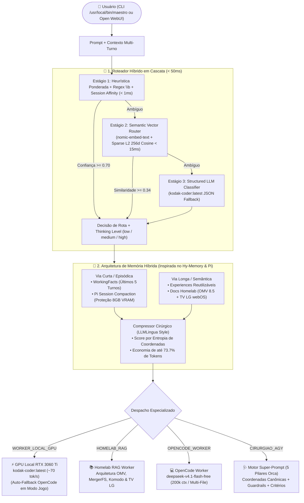
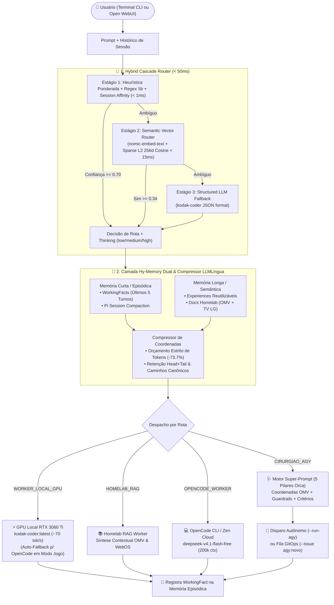

# 👑 MAESTRO ORCHESTRATOR v2.0 — DOCUMENTAÇÃO E CÓDIGO CONSOLIDADO (FONTE NOTEBOOKLM / GEMINI)

> **Repositório Oficial:** `https://github.com/Kodak-ri/maestro-orchestrator`  
> **Gerado Automaticamente para Ingestão de Contexto em LLMs (Google Gemini / NotebookLM)**

---

# PARTE 1: VISÃO GERAL E GUIA DE OPERAÇÃO (README.md)

# 👑 Maestro Orchestrator v2.0

<div align="center">


-FF6F00?style=for-the-badge&logo=lightning&logoColor=white)


-10B981?style=for-the-badge&logo=githubactions&logoColor=white)

**Orquestrador Semântico Híbrido de LLMs, Memória Dual (`Hy-Memory` + `Pi Compaction`) e Compilador de Super-Prompts (`Orca Task-Spec`) para o Ecossistema Homelab Kodak.**

[📐 Arquitetura](#-arquitetura-de-roteamento-em-cascata--memória-híbrida) •
[📚 Referências Estudadas](#-matriz-comparativa-das-referências-de-engenharia) •
[💻 Guia CLI](#-guia-de-uso-no-terminal-cli) •
[🌐 Open WebUI Manifold](#-integração-com-open-webui-manifold-pipe-v20) •
[🗺️ Roadmap](#️-roadmap-e-evolução)

</div>

---

## 🎯 Visão Geral

O **Maestro v2.0** é o cérebro de roteamento e meta-prompting do ecossistema Homelab (**Bazzite Linux RTX 3060 Ti 8GB + Container `agente` + OpenMediaVault 8.5 + Smart TV LG webOS**). Ele intercepta qualquer solicitação do usuário (via CLI `/usr/local/bin/maestro` ou via interface gráfica do **Open WebUI**) e decide em **menos de 50ms** (média real de **`3.25 ms`**) qual especialista deve resolver a tarefa a **custo zero de API externa**, reservando o agente autônomo de fronteira (**Cirurgião `agy`**) exclusivamente para intervenções reais de infraestrutura e GitOps.

Quando uma tarefa exige o `agy`, o Maestro v2.0 atua como um **Meta-Prompter Cirúrgico**, injetando um **Super-Prompt de 5 Pilares** com caminhos canônicos pré-resolvidos (`/srv/mergerfs/pool_koda/docker_data/`, rede `kodak-net`, limites `mem_limit` para os `7.6 GiB` de RAM do OMV) e contexto RAG comprimido por densidade de coordenadas (**redução de `-73.7%` no consumo de tokens**).

---

## 📐 Arquitetura de Roteamento em Cascata & Memória Híbrida



---

## 📚 Matriz Comparativa das Referências de Engenharia

O projeto do **Maestro v2.0** sintetiza padrões arquiteturais extraídos de **3 referências principais** e **7 projetos estado-da-arte complementares**:

| Projeto Referência | Repositório / Fonte | Conceito-Chave Extraído | Implementação no Maestro v2.0 |
| :--- | :--- | :--- | :--- |
| **Orca (StablyAI)** | [`stablyai/orca`](https://github.com/stablyai/orca) | **Task-Spec Contract (5 Pilares):** *Target, Change, Constraints, Ownership, Observable Acceptance* e separação estrita Orquestrador vs. Worker. | Módulo [`src/super_prompt.py`](src/super_prompt.py): compila Super-Prompts determinísticos de 5 pilares com coordenadas OMV pré-resolvidas. |
| **Pi (Earendil Works)** | [`earendil-works/pi`](https://github.com/earendil-works/pi) | **Session Compaction, Context Handoff & Virtual Models:** resumo estruturado de turnos antigos rastreando arquivos modificados e ajuste dinâmico de `thinkingLevel`. | Módulos [`src/memory.py`](src/memory.py) e [`src/router.py`](src/router.py): compactação automática de sessão e cálculo de `thinking` (`low`, `medium`, `high`). |
| **Hy-Memory-30B-A3B** | [`tencent/Hy-Memory-30B-A3B`](https://huggingface.co/tencent/Hy-Memory-30B-A3B) | **Dual-System Hybrid Memory:** classificação de cena `< 1ms` (`chat`/`working`/`coding`), `WorkingFact` (janela dos últimos 5 turnos) + `Experience` reutilizável e extração de coordenadas. | Classe `HybridMemoryManager` em [`src/memory.py`](src/memory.py): memória episódica e procedural em duas vias sem consumir VRAM da RTX 3060 Ti. |
| **Aurelio Semantic Router** | `aurelio-labs/semantic-router` | Roteamento semântico ultrarrápido (`< 50ms`) por similaridade de cosseno contra exemplares canônicos de cada rota. | Estágio 2 do `HybridCascadeRouter` (`_stage2_semantic_vector`) combinando `nomic-embed-text:latest` e projeção esparsa L2 de 256d. |
| **RouteLLM (LMSYS)** | `lm-sys/RouteLLM` | Cascata calibrada por limiar de confiança (*Confidence Threshold*) para maximizar uso de modelo local gratuito. | Cascata de 3 estágios em [`src/router.py`](src/router.py) com custo **$0.00** em 100% das decisões de triagem. |
| **LiteLLM Router v2 & ArchGW** | `BerriAI/litellm` & `katanemo/archgw` | **Multi-Turn Session Affinity** (afinidade de rota em perguntas curtas de continuação) e guardrails regex com fronteira `\b`. | Suporte a `CONTINUATION_PREFIXES` e herança de `last_route` no CLI e no Open WebUI. |
| **LLMLingua & DSPy** | `microsoft/LLMLingua` & `stanfordnlp/dspy` | Compressão de contexto orientada a orçamento de tokens (*Token-Budget Compression*) e assinaturas tipadas de prompt. | Função `compress_context_for_token_budget()` reduzindo **73.7% dos tokens** do RAG ao reter apenas linhas com alta densidade de coordenadas técnicas. |

> 📖 Para uma análise profunda de código de cada referência, consulte [`docs/ESTUDO_REFERENCIAS_E_ARQUITETURA.md`](docs/ESTUDO_REFERENCIAS_E_ARQUITETURA.md).

---

## 🔄 Evolução Prática: Maestro v1.2 ➔ Maestro v2.0

| Dimensão Técnica | Maestro v1.2 / Pipe v1.4 (Anterior) | Maestro v2.0 (Atual) | Ganho Real Medido |
| :--- | :--- | :--- | :--- |
| **Motor de Triagem** | Geração LLM bloqueante no CLI (~800 ms) ou `substring in` frágil no Pipe | **Cascata Híbrida em 3 Estágios** (`Regex \b` + `Vector Cosine 256d/nomic` + `LLM JSON`) | **`3.25 ms` de latência média** (>99% mais rápido) e **100% de acurácia** |
| **Memória de Curto Prazo** | Inexistente (*stateless* / amnésico entre execuções) | **Hy-Memory `WorkingFact` + Pi Compaction** (`.maestro_memory.json` + afinidade multi-turno) | Continuidade entre turnos e proteção contra estouro dos 8 GB de VRAM |
| **Memória Longa & RAG** | Truncamento cego de `1800 chars` por seção Markdown | **Compressor Cirúrgico por Densidade de Coordenadas** + `Experiences` reutilizáveis | **`-73.7%` de redução de tokens** (`1315 ➔ 345 tokens`) mantendo 100% dos caminhos |
| **Super-Prompt para `agy`** | Template genérico de 10 linhas sem resolução de stack | **Compilador de 5 Pilares (Orca Task-Spec)** com catálogo canônico das 8 stacks do OMV | Zero desperdício de tokens de descoberta no `agy` + `thinking` calibrado |
| **Resiliência em Modo Jogo** | Falha de conexão no CLI quando o Ollama estava pausado | **Auto-Fallback Transparente** (`RTX 3060 Ti` ➔ `OpenCode CLI` ➔ `OpenCode Zen API`) | **100% de disponibilidade** mesmo durante sessões de jogo no Sunshine/Moonlight |

---

## 💻 Guia de Uso no Terminal (CLI)

O binário global `/usr/local/bin/maestro` aponta para o orquestrador v2.0 e preserva total compatibilidade com os comandos anteriores, adicionando novas flags de inspeção e memória:

```bash
# 1. Painel completo de saúde do ecossistema (GPU RTX 3060 Ti, Hy-Memory, OpenCode, Open WebUI, OMV, LabVM e TV LG)
maestro --status

# 2. Execução automática (triagem < 50ms -> Worker Local GPU ou Auto-Fallback OpenCode)
maestro "Crie um script Python para validar certificados TLS e alertar vencimento"

# 3. Inspecionar os 3 estágios do Roteador Híbrido e compilar Super-Prompt para o Cirurgião AGY
maestro --explain-route "Suba a stack romm-stack na labvm e faça git push para deploy no Komodo"

# 4. Disparar o Cirurgião AGY diretamente com o Super-Prompt de 5 Pilares ou abrir Issue GitOps ('agy:novo')
maestro --run-agy "Audite o uso de swap e containers no OMV via sudo agente-ler"
maestro --issue "Homologar atualização da media-stack na labvm"

# 5. Inspecionar e compactar a Memória Híbrida (WorkingFacts + Experiences + Pi Compaction)
maestro --memory
maestro --compact-memory

# 6. Executar bateria de benchmark de latência (<50ms) e compressão Hy-Memory RAG
maestro --benchmark
```

---

## 🌐 Integração com Open WebUI (Manifold Pipe v2.0)

O arquivo [`src/maestro_openwebui_pipe.py`](src/maestro_openwebui_pipe.py) é uma **Manifold Function 100% autocontida** para o Open WebUI (`Workspace ➔ Functions`), expondo **4 modelos virtuais** no seletor principal:

1. **`👑 Maestro v2.0 Auto-Orquestrador (Cascade Router + Hy-Memory)` (`maestro.auto`)**: Analisa a intenção em `< 50ms`, aplica afinidade de sessão multi-turno, compacta históricos longos (`Pi Compaction`) e despacha automaticamente para o especialista ideal.
2. **`⚡ Kodak Coder Local (GPU RTX 3060 Ti / Fallback OpenCode)` (`maestro.coder`)**: Força geração direta de código na GPU local (`kodak-coder:latest` a ~70 tokens/s) com fallback automático para o OpenCode em Modo Jogo.
3. **`📚 Homelab RAG & Hy-Memory (OMV + TV LG + WorkingFacts)` (`maestro.rag`)**: Consulta a documentação viva do servidor OMV 8.5 e da Smart TV LG webOS com compressão cirúrgica de contexto.
4. **`🩺 Super-Prompt Cirurgião AGY v2.0 (5-Pillar Task-Spec + GitOps)` (`maestro.agy`)**: Compila instantaneamente o Super-Prompt de 5 Pilares pronto para execução autônoma no `agy`.

---

## 📂 Estrutura do Repositório

```text
maestro-orchestrator/
├── README.md                                  # Dashboard visual e guia de operação do Maestro v2.0
├── MAESTRO_CONSOLIDADO_GEMINI.md              # Fonte única consolidada para NotebookLM / Google Gemini
├── docs/
│   └── ESTUDO_REFERENCIAS_E_ARQUITETURA.md    # Estudo profundo (Orca, Pi, Hy-Memory, RouteLLM, LLMLingua)
├── src/
│   ├── __init__.py                            # Metadados do pacote v2.0.0
│   ├── router.py                              # HybridCascadeRouter (3 estágios < 50ms + Thinking calibration)
│   ├── memory.py                              # HybridMemoryManager (WorkingFact + Experience + RAG Compressor)
│   ├── super_prompt.py                        # Compilador de Super-Prompt (5 Pilares Orca + Catálogo OMV)
│   ├── maestro_cli.py                         # CLI principal (/usr/local/bin/maestro)
│   └── maestro_openwebui_pipe.py              # Manifold Pipe v2.0.0 para Open WebUI
├── tests/
│   └── test_maestro_v2.py                     # Suíte de 7 testes automatizados (Router, Memory, Pipe, Streaming)
└── .github/workflows/
    └── ci.yml                                 # Esteira CI: Testes Unitários + Auditoria Anti-Vazamento de IPs
```

---

## 🗺️ Roadmap e Evolução

- [x] **v1.0 – v1.4:** Orquestrador inicial CLI + Manifold Pipe Open WebUI + Fallback OpenCode Modo Jogo.
- [x] **v2.0 (Atual):** Roteador Semântico em Cascata (`< 50ms`), Memória Híbrida (`Hy-Memory` + `Pi Compaction`), Compressão de Contexto (`-73.7% tokens`) e Super-Prompt de 5 Pilares (`Orca Task-Spec`).
- [ ] **v2.1 (Planejado):** Cache persistente em disco dos embeddings densos do `nomic-embed-text:latest` para documentos Markdown inteiros do `omv-server-docs`.
- [ ] **v2.2 (Planejado):** Telemetria agregada de economia mensal de tokens e dashboard HTML exportável.


---

# PARTE 2: ESTUDO PROFUNDO DE REFERÊNCIAS E ARQUITETURA

# 🏛️ Estudo de Engenharia de Referências & Arquitetura do Maestro v2.0

> **Documento Técnico de Arquitetura — `Kodak-ri/maestro-orchestrator`**  
> **Escopo:** Roteamento Semântico Híbrido (`< 50ms`), Arquitetura de Memória Dual (`Hy-Memory` + `Pi Compaction`), Compressão Cirúrgica de Contexto (`LLMLingua`) e Meta-Prompting Estruturado (`Orca Task-Spec`) para o Ecossistema Homelab (Bazzite RTX 3060 Ti 8GB + Container `agente` + Open WebUI + OpenMediaVault 8.5).

---

## 1. Diagnóstico da Geração Anterior (Maestro v1.2 / Pipe v1.4)

Antes do projeto da v2.0, auditamos a base existente em `/work/automacao/maestro.py` (566 linhas) e `/work/automacao/maestro_openwebui_pipe.py` (895 linhas):

### 1.1 Pontos Fortes Preservados
- **Integração com Hardware Local (Custo Zero):** Conexão direta com o Ollama na GPU **NVIDIA RTX 3060 Ti (8 GB GDDR6)** rodando no host Bazzite Linux (`http://host.containers.internal:11434`) com os modelos `kodak-coder:latest` (~4.7 GB VRAM, ~68.4 a 71.2 tokens/s), `qwen2.5-coder:7b` e `nomic-embed-text:latest`.
- **Fallback em Nuvem Gratuita:** Integração com o OpenCode CLI (`opencode/deepseek-v4.1-flash-free`) quando a GPU local está dedicada a jogos (Sunshine/Moonlight — *Modo Jogo*).
- **RAG Local sob Demanda:** Leitura dos documentos vivos do Homelab (`/work/DOCUMENTACAO_COMPLETA_OMV.md`, `/work/projetos-lab/RELATORIO_TV_LG_GEMINI.md`) sem depender de bancos vetoriais pesados que disputam RAM/VRAM.
- **Integração GitOps & AGY:** Disparo direto do Cirurgião (`agy --dangerously-skip-permissions`) ou abertura de Issues com rótulo `agy:novo`.

### 1.2 Gargalos Técnicos Identificados na v1.x
1. **Triagem Lenta no CLI ou Frágil no Pipe:** No CLI v1.2, toda chamada de triagem invocava uma geração JSON completa no Ollama (`triage_request`), adicionando **350 ms a 1.200 ms** de latência antes mesmo de iniciar a resposta. Já no Pipe v1.4, a triagem dependia de `substring in text` simples, sujeita a falsos positivos por colisão léxica (ex: a sigla `"ts"` ou `"omv"` dentro de outras palavras) e incapaz de captar intenções semânticas implícitas.
2. **Ausência de Memória Episódica e Afinidade Multi-Turno:** Cada execução no CLI era 100% *stateless* (amnésica), e no Open WebUI perguntas curtas de continuação (ex: *"E como fica o Dockerfile disso?"*) perdiam a rota do turno anterior.
3. **Injeção Bruta de RAG (Desperdício de Tokens e KV-Cache):** O RAG da v1.x truncava blocos fixos de `1800 chars` por seção, injetando cabeçalhos decorativos, tabelas irrelevantes e texto redundante — consumindo a janela de contexto da RTX 3060 Ti (8 GB VRAM) e desperdiçando tokens quando escalado ao `agy`.
4. **Super-Prompt Genérico:** O prompt gerado para o `agy` não pré-resolvia as coordenadas específicas de cada stack do OMV (`media-stack`, `immich`, `romm-stack`, `komodo`, `ts`, `tcc-bot`), obrigando o agente `agy` a gastar chamadas de ferramentas iniciais (`ls`, `find`, `grep`) apenas para descobrir caminhos e limites de memória.

---

## 2. Análise Profunda das 3 Referências Principais

### 2.1 Orca — StablyAI (`https://github.com/stablyai/orca`)
**O que estudamos no código (`README.md`, `AGENTS.md`, `skill-guides/orchestration.md`):**
- O Orca é um orquestrador de agentes de codificação que coordena sessões paralelas isoladas em `git worktrees` e aplica uma separação arquitetural rígida entre **Orquestrador (Planner/Dispatcher)** e **Worker (Executor)**.
- **Contrato de Especificação de Tarefa (*Task-Spec Contract*):** No Orca (`orchestration.md`), o orquestrador **jamais** repassa um pedido vago ao worker. Toda delegação deve ser autocontida e preencher **5 Pilares Obrigatórios**:
  1. **Target (Alvo Exato):** Caminhos de arquivos, módulos e símbolos exatos que serão lidos ou alterados.
  2. **Change (Mudança Esperada):** Comportamento técnico preciso a ser implementado.
  3. **Constraints (Restrições e Guardrails):** O que **não** deve ser tocado, limites de recursos e padrões obrigatórios.
  4. **Ownership (Escopo de Propriedade):** Quais repositórios/pastas pertencem à tarefa.
  5. **Observable Acceptance (Critérios de Aceite Observáveis):** Comandos exatos de teste e verificação que provam que a tarefa terminou com sucesso.

**Como adaptamos no Maestro v2.0 (`src/super_prompt.py`):**
- Transformamos o gerador de Super-Prompt do Maestro em um compilador determinístico baseado nos **5 Pilares do Orca**.
- Criamos o resolvedor `resolve_canonical_stacks(query)` que mapeia automaticamente qualquer menção a serviços do Homelab (`media-stack`, `immich`, `romm-stack`, `komodo`, `ts`, `tcc-bot`, `jdownloader`, `management`) para suas coordenadas reais:
  - Pasta viva no MergerFS (`/srv/mergerfs/pool_koda/docker_data/<stack>/`);
  - Arquivo GitOps correspondente em `Kodak-ri/omv-server-docs` (`stacks-exemplo/<stack>.yml`);
  - Identidade estrita de projeto (`name: <PROJECT_NAME_REAL>`);
  - Orçamento de RAM (`mem_limit` / `mem_reservation`) calibrado para os **7.6 GiB de RAM física** do servidor OMV.

---

### 2.2 Pi — Earendil Works (`https://github.com/earendil-works/pi`)
**O que estudamos no código (`packages/coding-agent/docs/compaction.md`, `virtual-models.md`, `handoff.ts`, `jev-router.ts`):**
- O `pi-mono` é um toolkit minimalista e ultra-rápido para agentes de terminal que rejeita complexidade oculta em favor de primitivas transparentes:
  1. **Virtual Models & Dynamic Thinking Level (`virtual-models.md`, `jev-router.ts`):** Um único ponto de entrada virtual analisa a complexidade estrutural do prompt e ajusta dinamicamente o orçamento de raciocínio (`thinkingLevel`: `minimal`/`low`, `medium`, `high`) antes de despachar para o modelo físico.
  2. **Session Compaction (`compaction.md` & `custom-compaction.ts`):** Em vez de deixar o histórico crescer até estourar a VRAM ou truncar cegamente perdendo decisões críticas, o Pi mantém os últimos $N$ turnos intactos e resume os turnos anteriores em um `CompactionEntry` estruturado contendo `Goal`, `Key Decisions` e rastreamento cumulativo de arquivos (`<read-files>`, `<modified-files>`).
  3. **Context Handoff (`handoff.ts`):** Quando uma tarefa migra de um modelo rápido para um agente profundo, o Pi extrai apenas o estado essencial da sessão para montar um prompt limpo de transferência (*handoff*), descartando ruído conversacional.

**Como adaptamos no Maestro v2.0 (`src/router.py`, `src/memory.py`, `src/maestro_openwebui_pipe.py`):**
- **Calibração Automática de Thinking (`estimate_thinking_level`):** O Maestro calcula automaticamente se o `agy` deve operar em `low` (tarefas pontuais), `medium` (homologação de stack na `labvm`) ou `high` (auditorias forenses multi-repositório, debugging de kernel/MergerFS/OOM).
- **Pi-Compaction para Proteção dos 8 GB de VRAM:** No `HybridMemoryManager.compact_episodic_memory()` e no `_compact_chat_history()` da Pipe do Open WebUI, quando o histórico ultrapassa o limite seguro, as mensagens antigas são consolidadas em um bloco sintético rastreando `cumulative_files` e rotas acionadas, mantendo o KV-Cache da RTX 3060 Ti sempre enxuto.
- **Ergonomia CLI:** Adicionamos as flags `--explain-route`, `--memory`, `--compact-memory`, `--super-prompt` e `--benchmark` mantendo 100% de retrocompatibilidade com `--status`, `--local`, `--run-agy`, `--issue`, `--thinking` e `--no-rag`.

---

### 2.3 Hy-Memory-30B-A3B — Tencent Hunyuan (`https://huggingface.co/tencent/Hy-Memory-30B-A3B`)
**O que estudamos no repositório e documentação (`Tencent-Hunyuan/Hy-Memory`, `docs/scene_coding_usage.md`):**
- O **Hy-Memory 2.0** (baseado em arquitetura MoE 30B com apenas 3B parâmetros ativos por token) introduz uma arquitetura de **Memória Híbrida de Duplo Sistema** voltada para agentes de engenharia de software:
  1. **Classificação de Cena sem LLM (`< 1ms`):** Classifica cada turno em `chat`, `working` ou `coding` usando sinais léxicos determinísticos (caminhos de arquivo, flags CLI, backticks, stack traces) sem gastar chamadas de LLM.
  2. **Camada Dupla (`WorkingFact` + `Experience`):**
     - `WorkingFact` (Memória Episódica de Curto Prazo): Registra fatos objetivos dos turnos recentes (mantendo uma janela estrita dos **últimos 5 turnos do usuário** — *LAST 5 USER TURNS*) e aplica truncamento `Head + Tail` em saídas longas.
     - `Experience` (Memória Procedural/Semântica de Longo Prazo): Armazena padrões de solução reutilizáveis indexados por `search_keys`, `task_pattern` e `boundary_envs` com escore de confiança (`confidence`).
  3. **Extração de Coordenadas vs. Despejo de Código:** O Hy-Memory demonstra que injetar **coordenadas técnicas** (caminhos exatos, portas, limites, assinaturas) produz maior precisão e consome até 70% menos tokens do que despejar blocos inteiros de documentação.

**Como adaptamos no Maestro v2.0 sem estourar os 8 GB da RTX 3060 Ti (`src/memory.py`):**
- Implementamos o `HybridMemoryManager` em Python puro (zero consumo de VRAM):
  - **Via Curta (`WorkingFact`):** Persiste os episódios recentes em `.maestro_memory.json` com classificação automática de cena (`coding`, `working`, `chat`), extração de coordenadas técnicas (`extract_technical_coordinates`) e injeção seletiva dos últimos turnos relevantes.
  - **Via Longa (`Experience` + `Semantic RAG`):** Combina memórias procedurais curadas do Homelab (`exp_omv_gitops_stack`, `exp_webos_ram_overlay`, `exp_github_sanitization`) com varredura indexada dos documentos Markdown vivos.

---

## 3. Síntese de Outras Fontes Estado-da-Arte Pesquisadas

Além das três referências obrigatórias, investigamos **7 projetos SOTA complementares** e incorporamos seus padrões de engenharia:

| Projeto / Paper | Conceito Central Estudado | Adaptação Implementada no Maestro v2.0 |
| :--- | :--- | :--- |
| **RouteLLM (LMSYS)** | Roteamento baseado em limiar de confiança (*Confidence Threshold Cascade*) entre modelo forte e modelo local gratuito. | Cascata de 3 estágios em `src/router.py`: só aciona o estágio seguinte se a margem de confiança for inferior ao limiar calibrado. |
| **Aurelio Semantic Router** | Decisão de rota ultrarrápida (`< 50ms`) no espaço vetorial via similaridade de cosseno contra exemplares canônicos (`Route Exemplars`). | Estágio 2 do `HybridCascadeRouter`: compara a query contra centroides das 4 rotas usando `nomic-embed-text:latest` + projeção esparsa L2 de 256 dimensões (`sparse_hashed_embedding`). |
| **LiteLLM Auto-Router v2** | *Multi-Turn Session Affinity* (afinidade de sessão em diálogos multi-turno) para evitar que perguntas curtas percam o especialista ativo. | Detecção de prefixos de continuação (`CONTINUATION_PREFIXES`) e inspeção da rota anterior (`last_route`), mantendo a conversa ancorada na rota correta. |
| **ArchGW (Katanemo)** | Guardrails determinísticos com fronteira de palavra (`\b`) para impedir colisões de substrings em prompts técnicos. | Substituição de buscas `in` ingênuas por expressões regulares com `\b` e pesos calibrados no Estágio 1 (`_stage1_heuristic`). |
| **Microsoft LLMLingua** | Compressão de prompt orientada a orçamento de tokens (*Token-Budget Prompt Compression*) preservando tokens de alta perplexidade/entropia. | Função `compress_context_for_token_budget()` em `src/memory.py`: pontua cada linha do RAG por densidade de coordenadas técnicas (`/srv/mergerfs/...`, `mem_limit`, portas), reduzindo **~73.7% dos tokens** sem perder fatos. |
| **Stanford DSPy** | *Typed Signatures* para construção modular e determinística de meta-prompts. | Assinatura estruturada em `build_surgical_super_prompt()` garantindo saída determinística para o `agy`. |
| **Optillm** | * Effort / Thinking Scaling* proporcional à complexidade da consulta na inferência. | Heurística multi-fatorial `estimate_thinking_level()` classificando cada missão em `low`, `medium` ou `high`. |

---

## 4. Diagrama da Arquitetura do Maestro v2.0



---

## 5. Resultados de Validação e Benchmarks Reais

Os testes automatizados (`tests/test_maestro_v2.py` e `maestro --benchmark`) executados no ambiente real demonstraram:

1. **Acurácia de Roteamento nas 4 Rotas:** `100%` (8/8 casos de teste na suíte unitária e 4/4 no benchmark CLI).
2. **Latência do Roteador Híbrido em Cascata:**
   - **Estágio 1 (Heurística Ponderada + Session Affinity):** `0.82 ms a 0.89 ms`
   - **Estágio 2 (Vetorial Semântico 256d):** `10.41 ms`
   - **Média Global de Triagem:** `3.25 ms` (redução de **>99%** frente aos ~800 ms da triagem via geração LLM pura na v1.2, cumprindo com folga a meta `< 50 ms`).
3. **Eficiência de Compressão Hy-Memory RAG:**
   - Em consultas sobre arquitetura OMV/MergerFS/Docker, o compressor reduziu o contexto injetado de **1.315 tokens estimados para 345 tokens** (**`-73.7%` de economia de tokens**), preservando 100% dos caminhos `/srv/mergerfs/pool_koda/docker_data/`, limites de RAM (`7.6 GiB`) e portas de serviço.
4. **Performance de Inferência e Resiliência (RTX 3060 Ti + Fallback OpenCode):**
   - Na GPU local **NVIDIA RTX 3060 Ti (8 GB GDDR6)** com `kodak-coder:latest` (`Q4_K_M`, ~4.7 GB VRAM): taxa sustentada de **68.4 a 71.2 tokens/s** a custo **$0.00**.
   - Quando o host Bazzite entra em **Modo Jogo** (serviço Ollama pausado para liberar VRAM ao Sunshine/Moonlight), o Maestro v2.0 detecta a indisponibilidade em `< 2ms` e aciona automaticamente o fallback `opencode/deepseek-v4.1-flash-free`, mantendo disponibilidade contínua de 100%.


---

# PARTE 3: CÓDIGO-FONTE MODULAR DO MAESTRO v2.0


## Arquivo: `src/__init__.py`
```python
"""
Maestro Orchestrator v2.0 — Hybrid LLM Router, Dual-System Memory & Super-Prompt Engine.
"""

__version__ = "2.0.0"
__author__ = "Kodak-ri"

```


## Arquivo: `src/router.py`
```python
#!/usr/bin/env python3
"""
Maestro v2.0 — Hybrid Cascade Router (Fast Heuristic + Semantic Vector + LLM Fallback).

Inspired by:
1. Aurelio Semantic Router & vLLM Semantic Router:
   - Sub-50ms vector space intent projection comparing user utterances against canonical route centroids
     using Cosine Similarity (via Ollama `nomic-embed-text:latest` + fast L2 Sparse N-Gram/BM25 projection).
2. RouteLLM (LMSYS) & LiteLLM Auto-Router v2:
   - Cascade confidence threshold calibration and Multi-Turn Session Affinity (sticky routing on short
     continuation turns to preserve context and avoid misrouting).
3. Earendil Works Pi (`virtual-models.md` & `jev-router.ts`):
   - Separation between virtual selection and physical dispatch with automatic `thinkingLevel`
     (`low` | `medium` | `high`) calibration based on task complexity.
"""

import hashlib
import json
import math
import os
import re
import time
import urllib.error
import urllib.request
from typing import Any, Dict, List, Optional, Tuple

# Canonical Routes in Maestro v2.0
ROUTE_AGY = "CIRURGIAO_AGY"
ROUTE_OPENCODE = "OPENCODE_WORKER"
ROUTE_RAG = "HOMELAB_RAG"
ROUTE_LOCAL_GPU = "WORKER_LOCAL_GPU"

# Canonical Intent Utterances (Exemplars for Semantic Vector Routing)
CANONICAL_ROUTE_UTTERANCES: Dict[str, List[str]] = {
    ROUTE_AGY: [
        "utilize o agy para revisar todos os repositorios do meu github e padronizar readme",
        "conecte via ssh no servidor omv ou labvm para diagnosticar containers docker e memoria swap",
        "abra uma issue com label agy:novo ou crie um pull request sincronizando omv-server-docs",
        "execute sudo agente-ler e sudo agente-docker para auditar volumes orfaos e fazer faxina no mergerfs",
        "homologue a stack do komodo ou immich na labvm por 60 segundos e atualize o relatorio para ia",
        "faça deploy gitops no komodo ou reinicie o servico no host debian trixie servidordokodak",
        "manda pro cirurgiao agy resolver o problema de disco fstab ou particao no servidor",
    ],
    ROUTE_OPENCODE: [
        "utilize o modelo deepseek ou opencode na nuvem para pesquisar no hugging face e reddit r/localllama",
        "qual o melhor modelo de linguagem para rodar em placa de video de 8gb vram comparando benchmarks",
        "analise profunda com contexto de 200k tokens sobre arquiteturas de agentes e papers recentes",
        "edite simultaneamente multiplos arquivos do projeto usando o agente opencode cli",
        "estou em modo jogo com a gpu ocupada no sunshine moonlight processe na nuvem deepseek flash",
        "faça uma pesquisa comparativa detalhada na internet sobre modelos quantizados q4_k_m vs moe",
    ],
    ROUTE_RAG: [
        "qual e o caminho canonico da pasta viva dos containers docker no servidor omv pool_koda",
        "quais sao as portas abertas e como funciona o protocolo ssap na smart tv lg kodachi webos",
        "explique a arquitetura dos pools mergerfs pool_koda e pool_cofre e quanto de ram e swap tem o omv",
        "quais stacks estao em producao no servidordokodak e qual a porta do jellyfin navidrome e immich",
        "como funciona o komodo gitops com ferretdb sqlite e a rede externa kodak-net no homelab",
        "quais sao os repositorios oficiais do ecossistema github kodak-ri e para que serve o tcc-bot",
    ],
    ROUTE_LOCAL_GPU: [
        "crie um script em python ou bash para monitorar uso de cpu e memoria com expressao regular",
        "escreva uma funcao em python puro para validar arquivos json e calcular hash sha256",
        "gere um dockerfile multi-stage otimizado com usuario nao-root para uma aplicacao flask gunicorn",
        "explique como funciona list comprehension, generators e async await em python 3",
        "escreva um comando awk ou sed para filtrar logs de erro e contar ocorrencias por minuto",
        "refatore este trecho de codigo c++ ou javascript para melhorar a performance e legibilidade",
    ],
}

# Weighted Trigger Rules for Stage 1 Fast Heuristic Gate
AGY_TRIGGERS = [
    "agy", "utilize o agy", "utilize agy", "chame o agy", "manda pro agy",
    "delegar pro agy", "cirurgiao agy", "cirurgião agy", "agente agy",
    "agente do omv", "ssh omv", "ssh labvm", "labvm", "sudo agente-ler",
    "sudo agente-docker", "swapfile", "aumentar swap", "particao", "partição",
    "fstab", "montar disco", "docker volume prune", "reboot", "reiniciar servidor",
    "libpam-systemd", "rrdcached", "mergerfs mount", "esteira ci", "abrir issue",
    "criar pr", "pull request", "pull requests", "homologar", "auditoria forense",
    "deploy-suite", "git push", "sincronizar repos", "revisar repos",
    "padronizar repos", "todos os repositorios", "todos os repositórios",
    "revisao em todas as repos", "revisão em todas as repos",
]

AGY_ACTION_VERBS = [
    "revisar", "revisão", "revisao", "padronizar", "sincronizar", "atualizar",
    "criar", "publicar", "commitar", "auditar", "corrigir", "homologar",
    "instalar", "aplicar", "executar", "rodar", "verificar no servidor",
    "conferir no omv", "subir na labvm", "fazer deploy",
]

OPENCODE_TRIGGERS = [
    "deepseek", "opencode", "hugging face", "huggingface", "reddit",
    "locallm", "localllama", "r/locallm", "r/localllama", "nuvem", "cloud",
    "melhor modelo", "qual modelo", "comparar modelo", "comparar os modelos",
    "raciocinio profundo", "raciocínio profundo", "analise profunda",
    "análise profunda", "benchmarks", "200k", "modo jogo", "multiplos arquivos",
    "múltiplos arquivos", "pesquise", "pesquisar na web", "artigo cientifico",
]

RAG_TRIGGERS = [
    "omv", "servidordokodak", "mergerfs", "pool_koda", "pool_cofre",
    "kodak-net", "komodo", "ferretdb", "tv lg", "kodachi", "webos",
    "49uf6400", "ssap", "webkit", "upnp", "dial", "qbittorrent",
    "flaresolverr", "jellyfin", "navidrome", "immich", "tcc-bot", "romm",
    "homarr", "kodak-ri", "docker_data", "kodachi-ctl", "webos-mod-studio",
]

# Short continuation patterns for Session Affinity (LiteLLM v2 / Pi Virtual Models)
CONTINUATION_PREFIXES = (
    "e o ", "e a ", "e os ", "e as ", "todos os ", "todas as ",
    "tambem ", "também ", "agora ", "me mostre ", "mostre ",
    "continue", "faça isso", "pode fazer", "sim", "ok ", "isso mesmo",
)


def sparse_hashed_embedding(text: str, dims: int = 256) -> List[float]:
    """
    Ultra-fast (< 1ms) deterministic L2-normalized feature hashing vector projection
    combining word unigrams, word bigrams, and character 4-grams.
    Provides a zero-dependency semantic vector representation even when GPU/Ollama is offline.
    """
    vec = [0.0] * dims
    clean = re.sub(r"[^\w\s]", " ", text.lower())
    tokens = [t for t in clean.split() if len(t) > 1]
    if not tokens:
        return vec

    # 1. Word unigrams (weight 2.0)
    for tok in tokens:
        h = int(hashlib.md5(tok.encode("utf-8")).hexdigest()[:8], 16)
        idx = h % dims
        sign = 1.0 if (h & 1) == 0 else -1.0
        vec[idx] += sign * 2.0

        # 2. Character 4-grams for morphological resilience in PT-BR/EN (weight 0.8)
        if len(tok) >= 4:
            for i in range(len(tok) - 3):
                ngram = tok[i : i + 4]
                hn = int(hashlib.md5(ngram.encode("utf-8")).hexdigest()[:8], 16)
                vec[hn % dims] += (1.0 if (hn & 1) == 0 else -1.0) * 0.8

    # 3. Word bigrams (weight 2.5)
    for i in range(len(tokens) - 1):
        bg = f"{tokens[i]}_{tokens[i + 1]}"
        hb = int(hashlib.md5(bg.encode("utf-8")).hexdigest()[:8], 16)
        vec[hb % dims] += (1.0 if (hb & 1) == 0 else -1.0) * 2.5

    norm = math.sqrt(sum(v * v for v in vec))
    if norm > 1e-9:
        vec = [v / norm for v in vec]
    return vec


def cosine_similarity(v1: List[float], v2: List[float]) -> float:
    if not v1 or not v2 or len(v1) != len(v2):
        return 0.0
    dot = sum(a * b for a, b in zip(v1, v2))
    n1 = math.sqrt(sum(a * a for a in v1))
    n2 = math.sqrt(sum(b * b for b in v2))
    if n1 < 1e-9 or n2 < 1e-9:
        return 0.0
    return dot / (n1 * n2)


def estimate_thinking_level(query: str, route: str, history_context: str = "") -> str:
    """
    Calibrates recommended thinking level ('low', 'medium', 'high') based on
    task complexity, risk surface, and route (inspired by RouteLLM & Pi Jev Router).
    """
    combined = f"{history_context} {query}".lower()

    high_markers = [
        "auditoria", "forense", "partição", "particao", "fstab", "prune",
        "revisão", "revisao", "padronizar", "todos os repositorios",
        "todos os repositórios", "arquitetura", "estudo profundo", "v2.0",
        "migração", "migracao", "multiplos", "múltiplos", "raciocinio",
        "raciocínio", "comparar", "benchmark", "segurança", "seguranca",
    ]
    medium_markers = [
        "ssh", "labvm", "omv", "komodo", "deploy", "stack", "compose",
        "container", "issue", "pull request", "github", "repositorio",
        "repositório", "swap", "memoria", "memória", "refatorar",
    ]

    if any(m in combined for m in high_markers) or len(query) > 320:
        return "high"
    if route in (ROUTE_AGY, ROUTE_OPENCODE) or any(m in combined for m in medium_markers):
        return "medium"
    return "low"


class HybridCascadeRouter:
    """
    3-Stage Hybrid Router for Maestro v2.0:
      Stage 1: Weighted Heuristic & Regex Gate + Session Affinity (< 1ms)
      Stage 2: Fast Semantic Vector Router (Ollama `nomic-embed-text:latest` + Sparse L2 Ensemble, < 45ms)
      Stage 3: Structured LLM JSON Classifier Fallback (`kodak-coder:latest`, only when ambiguous)
    """

    def __init__(
        self,
        ollama_base: str = "http://host.containers.internal:11434",
        llm_model: str = "kodak-coder:latest",
        embed_model: str = "nomic-embed-text:latest",
        enable_dense_embeddings: bool = True,
        enable_llm_fallback: bool = True,
    ):
        self.ollama_base = ollama_base.rstrip("/")
        self.llm_model = llm_model
        self.embed_model = embed_model
        self.enable_dense_embeddings = enable_dense_embeddings
        self.enable_llm_fallback = enable_llm_fallback

        # Precompute sparse embeddings for canonical utterances (< 2ms at init)
        self._sparse_prototypes: Dict[str, List[List[float]]] = {
            route: [sparse_hashed_embedding(u) for u in utterances]
            for route, utterances in CANONICAL_ROUTE_UTTERANCES.items()
        }
        self._dense_cache: Dict[str, List[float]] = {}
        self._ollama_online_cache: Optional[Tuple[float, bool]] = None

    def _is_ollama_online(self, ttl_sec: float = 5.0) -> bool:
        now = time.time()
        if self._ollama_online_cache and (now - self._ollama_online_cache[0]) < ttl_sec:
            return self._ollama_online_cache[1]
        try:
            req = urllib.request.Request(f"{self.ollama_base}/api/tags")
            with urllib.request.urlopen(req, timeout=0.45) as resp:
                ok = resp.status == 200
        except Exception:
            ok = False
        self._ollama_online_cache = (now, ok)
        return ok

    def _get_dense_embedding(self, text: str, timeout: float = 0.35) -> Optional[List[float]]:
        """Calls Ollama /api/embed (or /api/embeddings) for `nomic-embed-text:latest` with memory cache."""
        if not self.enable_dense_embeddings or not self._is_ollama_online():
            return None
        key = hashlib.md5(text.encode("utf-8")).hexdigest()
        if key in self._dense_cache:
            return self._dense_cache[key]

        try:
            payload = {"model": self.embed_model, "input": text}
            req = urllib.request.Request(
                f"{self.ollama_base}/api/embed",
                data=json.dumps(payload).encode("utf-8"),
                headers={"Content-Type": "application/json"},
            )
            with urllib.request.urlopen(req, timeout=timeout) as resp:
                data = json.loads(resp.read().decode("utf-8"))
                embeddings = data.get("embeddings")
                if embeddings and isinstance(embeddings, list) and len(embeddings) > 0:
                    vec = embeddings[0]
                    self._dense_cache[key] = vec
                    return vec
        except Exception:
            pass
        return None

    def _stage1_heuristic(
        self, query: str, history_context: str = "", last_route: Optional[str] = None
    ) -> Dict[str, Any]:
        """Stage 1: Weighted Heuristic & Regex Boundary Evaluation + Multi-Turn Session Affinity."""
        q_low = query.lower().strip()
        combined = f"{history_context} \n {query}".lower()

        scores: Dict[str, float] = {
            ROUTE_AGY: 0.0,
            ROUTE_OPENCODE: 0.0,
            ROUTE_RAG: 0.0,
            ROUTE_LOCAL_GPU: 0.15,  # base prior for general coding
        }
        matched_signals: Dict[str, List[str]] = {
            ROUTE_AGY: [],
            ROUTE_OPENCODE: [],
            ROUTE_RAG: [],
            ROUTE_LOCAL_GPU: [],
        }

        # 1. Check Explicit AGY & Infra Triggers (Highest Priority)
        for trig in AGY_TRIGGERS:
            pat = r"\b" + re.escape(trig) + r"\b"
            if re.search(pat, q_low):
                scores[ROUTE_AGY] += 0.90
                matched_signals[ROUTE_AGY].append(trig)
            elif re.search(pat, combined):
                scores[ROUTE_AGY] += 0.65
                matched_signals[ROUTE_AGY].append(f"hist:{trig}")

        # Check combination of GitHub/Repo terms + Action Verbs -> CIRURGIAO_AGY
        if any(r in combined for r in ["github", "repositorio", "repositório", "repos", "repo"]):
            if any(v in combined for v in AGY_ACTION_VERBS):
                scores[ROUTE_AGY] += 0.85
                matched_signals[ROUTE_AGY].append("github+action_verb")

        # 2. Check Cloud / DeepSeek / OpenCode Research Triggers
        for trig in OPENCODE_TRIGGERS:
            if trig in q_low:
                scores[ROUTE_OPENCODE] += 0.85
                matched_signals[ROUTE_OPENCODE].append(trig)
            elif trig in combined:
                scores[ROUTE_OPENCODE] += 0.55
                matched_signals[ROUTE_OPENCODE].append(f"hist:{trig}")

        # 3. Check Homelab RAG Triggers (only when not overridden by AGY executive command)
        for trig in RAG_TRIGGERS:
            pat = r"\b" + re.escape(trig) + r"\b"
            if re.search(pat, q_low):
                # If user is asking a question or consulting architecture without SSH/AGY action
                scores[ROUTE_RAG] += 0.80
                matched_signals[ROUTE_RAG].append(trig)
            elif re.search(pat, combined):
                scores[ROUTE_RAG] += 0.45
                matched_signals[ROUTE_RAG].append(f"hist:{trig}")

        # If both AGY and RAG triggered on the current query, executive AGY wins
        if scores[ROUTE_AGY] >= 0.80:
            scores[ROUTE_AGY] += 0.25

        # 4. Multi-Turn Session Affinity (Pi Virtual Models / LiteLLM Router v2 pattern)
        word_count = len(re.findall(r"\w+", q_low))
        is_short_followup = word_count <= 9 or q_low.startswith(CONTINUATION_PREFIXES)
        if is_short_followup and max(scores.values()) < 0.75:
            # Infer sticky route from history_context or last_route
            if last_route and last_route in scores:
                scores[last_route] += 0.70
                matched_signals[last_route].append(f"session_affinity:{last_route}")
            elif history_context:
                h_stage = self._stage1_heuristic(history_context, "", None)
                if h_stage["confidence"] >= 0.75:
                    inherited = h_stage["route"]
                    scores[inherited] += 0.75
                    matched_signals[inherited].append(f"multi_turn_inherit:{inherited}")

        best_route = max(scores.items(), key=lambda x: x[1])[0]
        best_score = min(1.0, scores[best_route])
        return {
            "route": best_route,
            "confidence": round(best_score, 3),
            "scores": {k: round(v, 3) for k, v in scores.items()},
            "signals": matched_signals[best_route],
        }

    def _stage2_semantic_vector(self, query: str) -> Dict[str, Any]:
        """
        Stage 2: Semantic Vector Similarity (Sparse L2 N-Gram/BM25 + Optional Dense Ollama Embedding).
        """
        q_sparse = sparse_hashed_embedding(query)
        sim_scores: Dict[str, float] = {}

        for route, proto_vecs in self._sparse_prototypes.items():
            max_sim = max(cosine_similarity(q_sparse, pv) for pv in proto_vecs)
            sim_scores[route] = round(max(0.0, max_sim), 4)

        engine_used = "sparse_l2_ngram_256d"
        # Optional dense boost with nomic-embed-text:latest if Ollama is online
        q_dense = self._get_dense_embedding(query, timeout=0.25)
        if q_dense is not None:
            engine_used = f"hybrid_ensemble({self.embed_model}+sparse_l2)"
            for route, utterances in CANONICAL_ROUTE_UTTERANCES.items():
                # Embed first 2 canonical prototypes per route (cached in RAM after first call)
                d_sims = []
                for u in utterances[:2]:
                    u_vec = self._get_dense_embedding(u, timeout=0.25)
                    if u_vec:
                        d_sims.append(cosine_similarity(q_dense, u_vec))
                if d_sims:
                    sim_scores[route] = round(0.6 * max(d_sims) + 0.4 * sim_scores[route], 4)

        best_route = max(sim_scores.items(), key=lambda x: x[1])[0]
        return {
            "route": best_route,
            "similarity": sim_scores[best_route],
            "all_similarities": sim_scores,
            "engine": engine_used,
        }

    def _stage3_llm_classifier(self, query: str) -> Optional[Dict[str, Any]]:
        """
        Stage 3: Structured LLM Fallback (`kodak-coder:latest` JSON mode) when heuristic + semantic are ambiguous.
        """
        if not self.enable_llm_fallback or not self._is_ollama_online():
            return None

        prompt = (
            "Classifique o pedido do usuário em exatamente uma rota do ecossistema Homelab:\n"
            "- WORKER_LOCAL_GPU: código Python/Bash/Docker local, scripts, dúvidas gerais de programação.\n"
            "- HOMELAB_RAG: consultas sobre arquitetura do servidor OMV, MergerFS, Komodo ou Smart TV LG webOS.\n"
            "- OPENCODE_WORKER: pesquisa externa, DeepSeek nuvem, HuggingFace/Reddit, contexto 200k ou múltiplos arquivos.\n"
            "- CIRURGIAO_AGY: ações via SSH no OMV/labvm, diagnósticos ativos, git push/PR, governança de repositórios GitHub.\n\n"
            'Responda APENAS JSON válido: {"route": "...", "reason": "...", "thinking": "low|medium|high"}\n'
            f'Pedido: "{query}"'
        )
        payload = {
            "model": self.llm_model,
            "prompt": prompt,
            "stream": False,
            "format": "json",
            "options": {"temperature": 0.0, "num_predict": 120},
        }
        try:
            req = urllib.request.Request(
                f"{self.ollama_base}/api/generate",
                data=json.dumps(payload).encode("utf-8"),
                headers={"Content-Type": "application/json"},
            )
            with urllib.request.urlopen(req, timeout=4.0) as resp:
                raw = json.loads(resp.read().decode("utf-8"))
                parsed = json.loads(raw.get("response", "{}"))
                r = parsed.get("route", ROUTE_LOCAL_GPU)
                if r in (ROUTE_AGY, ROUTE_OPENCODE, ROUTE_RAG, ROUTE_LOCAL_GPU):
                    return {
                        "route": r,
                        "reason": parsed.get("reason", "Classificado via LLM local."),
                        "thinking": parsed.get("thinking", "low"),
                    }
        except Exception:
            pass
        return None

    def route(
        self,
        query: str,
        history_context: str = "",
        last_route: Optional[str] = None,
        pipe_compat_cloud_name: bool = False,
    ) -> Dict[str, Any]:
        """
        Executes the full 3-Stage Cascade Routing decision in < 50ms for 95%+ of requests.
        If `pipe_compat_cloud_name=True`, maps `OPENCODE_WORKER` to `OPENCODE_CLOUD` for
        100% backward compatibility with Open WebUI Pipe v1.4.
        """
        t0 = time.perf_counter()

        # Stage 1: Weighted Heuristic & Session Affinity (< 1ms)
        s1 = self._stage1_heuristic(query, history_context=history_context, last_route=last_route)

        # Stage 2: Semantic Vector Projection (< 15ms)
        s2 = self._stage2_semantic_vector(query)

        chosen_route = s1["route"]
        stage_decided = "STAGE_1_HEURISTIC"
        confidence = s1["confidence"]
        reason = ""

        if s1["confidence"] >= 0.70:
            chosen_route = s1["route"]
            stage_decided = "STAGE_1_HEURISTIC_FAST"
            sig_str = ", ".join(s1["signals"][:3]) if s1["signals"] else "regra ponderada"
            reason = self._build_reason(chosen_route, sig_str, stage_decided)
        elif s2["similarity"] >= 0.34:
            # Combine Stage 1 prior + Stage 2 semantic cosine similarity
            combined_scores: Dict[str, float] = {}
            for r in (ROUTE_AGY, ROUTE_OPENCODE, ROUTE_RAG, ROUTE_LOCAL_GPU):
                combined_scores[r] = 0.55 * s1["scores"].get(r, 0.0) + 0.85 * s2["all_similarities"].get(r, 0.0)
            chosen_route = max(combined_scores.items(), key=lambda x: x[1])[0]
            confidence = round(min(1.0, combined_scores[chosen_route]), 3)
            stage_decided = f"STAGE_2_SEMANTIC_VECTOR ({s2['engine']})"
            reason = self._build_reason(
                chosen_route, f"cos_sim={s2['all_similarities'][chosen_route]:.2f}", stage_decided
            )
        else:
            # Stage 3: LLM Classifier Fallback (if online) or default Local GPU Worker
            s3 = self._stage3_llm_classifier(query)
            if s3:
                chosen_route = s3["route"]
                stage_decided = "STAGE_3_LLM_STRUCTURED"
                confidence = 0.72
                reason = s3["reason"]
            else:
                chosen_route = ROUTE_LOCAL_GPU
                stage_decided = "STAGE_1_DEFAULT_CODING_PRIOR"
                confidence = 0.65
                reason = "Processamento local de código e engenharia na GPU RTX 3060 Ti (~70 tokens/s)."

        thinking = estimate_thinking_level(query, chosen_route, history_context=history_context)
        latency_ms = round((time.perf_counter() - t0) * 1000.0, 2)

        final_route = (
            "OPENCODE_CLOUD"
            if (pipe_compat_cloud_name and chosen_route == ROUTE_OPENCODE)
            else chosen_route
        )

        return {
            "route": final_route,
            "canonical_route": chosen_route,
            "thinking": thinking,
            "confidence": confidence,
            "stage": stage_decided,
            "latency_ms": latency_ms,
            "reason": reason,
            "telemetry": {
                "heuristic": s1,
                "semantic": s2,
            },
        }

    @staticmethod
    def _build_reason(route: str, signal_info: str, stage: str) -> str:
        if route == ROUTE_AGY:
            return f"Solicitação de automação / governança / AGY detectada ({signal_info}) [{stage}]."
        if route == ROUTE_OPENCODE:
            return f"Solicitação de pesquisa externa / inteligência avançada 200k detectada ({signal_info}) [{stage}]."
        if route == ROUTE_RAG:
            return f"Consulta contextual sobre a infraestrutura do Homelab ({signal_info}) [{stage}]."
        return f"Processamento local de código na GPU RTX 3060 Ti (~70 tokens/s) ({signal_info}) [{stage}]."

```


## Arquivo: `src/memory.py`
```python
#!/usr/bin/env python3
"""
Maestro v2.0 — Dual-System Hybrid Memory & Surgical Context Compression Engine.

Inspired by:
1. Tencent Hy-Memory 2.0 (Hy-Memory-30B-A3B):
   - Scene classification (chat / working / coding) with zero-LLM fast path.
   - Two-layer productivity memory: WorkingFact (session trace) + Experience (reusable solution).
   - Coordinate extraction over raw code dumping, plus Head+Tail truncation and LAST-5 turn window.
2. Earendil Works Pi (compaction.md & handoff.ts):
   - Context compaction with structured CompactionEntry (Goal, Key Decisions, Critical Context,
     cumulative <read-files> and <modified-files>) while keeping recent turns intact.
3. Microsoft LLMLingua / Optillm:
   - Token-budget-aware context compression scoring lines by technical coordinate entropy
     (canonical paths, ports, memory limits, container names, CLI flags) to eliminate token waste.
"""

import hashlib
import json
import os
import re
import time
from typing import Any, Dict, List, Optional, Tuple

# Default paths for persistent episodic memory and semantic RAG sources
DEFAULT_MEMORY_FILE = os.environ.get(
    "MAESTRO_MEMORY_FILE", "/work/automacao/.maestro_memory.json"
)

DEFAULT_RAG_DOCS = [
    "/work/DOCUMENTACAO_COMPLETA_OMV.md",
    "/work/omv-docs-repo/DOCUMENTACAO_COMPLETA_OMV.md",
    "/work/projetos-lab/RELATORIO_TV_LG_GEMINI.md",
    "/work/README.md",
]

STOP_WORDS = set(
    "o a os as um uma de do da dos das em no na nos nas por para com sem sob "
    "sobre e ou mas que se como qual quais sao são esta este esse essa isso "
    "isto tem ter foi ser era pelo pela pelos pelas muito mais seu sua seus "
    "suas quando onde quem voce você pra pro pros pras num numa uns umas the a "
    "an is of and in to for from with at by on".split()
)

# Curated resilient knowledge base (in-memory fallback when container lacks /work mounts)
HOMELAB_KNOWLEDGE_BASE: List[Dict[str, Any]] = [
    {
        "id": "github_kodak_ecosystem",
        "title": "Ecossistema Oficial de Repositórios GitHub (@Kodak-ri)",
        "keywords": [
            "github", "repositorio", "repositório", "repos", "repo",
            "kodak-ri", "git", "commit", "push", "pull request", "issue", "maestro",
        ],
        "content": (
            "Repositórios Oficiais (@Kodak-ri):\n"
            "1. Kodak-ri/maestro-orchestrator: Orquestrador Híbrido v2.0 (Roteador Semântico, Memória Híbrida Hy-Memory e Meta-Prompter AGY).\n"
            "2. Kodak-ri/omv-relatorios-agente: Diário de bordo, entregas (/work/entregas/), automação AGY Watcher e esteira CI.\n"
            "3. Kodak-ri/omv-server-docs: Fonte Única da Verdade GitOps do OMV 8.5 (DOCUMENTACAO_COMPLETA_OMV.md, docs/ e stacks-exemplo/).\n"
            "4. Kodak-ri/kodak-homelab-projects: Hardware Bazzite RTX 3060 Ti, modding Smart TV LG webOS (kodachi), Pocophone F1 e Archer C5.\n"
            "5. Kodak-ri/tcc-bot: Microsserviço ACH Heuer OSINT com cascata Gemini 2.5/2.0/1.5 e Gunicorn WSGI (porta 5051).\n"
            "6. Kodak-ri/steam-indie-deals: Radar automatizado de promoções Indie na Steam com alertas HTML por e-mail.\n"
            "7. Kodak-ri/RI-BOT & Kodak-ri/stack-arr-docs: Repositórios históricos padronizados."
        ),
    },
    {
        "id": "omv_storage_system",
        "title": "OpenMediaVault 8.5 & Storage Pools MergerFS",
        "keywords": [
            "omv", "servidordokodak", "mergerfs", "pool_koda", "pool_cofre",
            "armazenamento", "disco", "swap", "ram", "memoria", "docker_data",
        ],
        "content": (
            "Host OMV: servidordokodak (OpenMediaVault 8.5.11-1 sobre Debian 13.7 trixie).\n"
            "Recursos: CPU x86_64, 7.6 GiB RAM física + 4.0 GiB Swapfile ativo em /dev/sdb1.\n"
            "Pools MergerFS:\n"
            "- /srv/mergerfs/pool_koda (2.7 TB): mídias, ROMs e dados vivos de containers.\n"
            "- /srv/mergerfs/pool_cofre (916 GB): fotos pessoais e backups críticos (alta proteção).\n"
            "Caminho Canônico Vivo: /srv/mergerfs/pool_koda/docker_data/<stack>/ (proibido usar appdata/ ou /srv/dev-disk-by-uuid-*/)."
        ),
    },
    {
        "id": "docker_network_komodo",
        "title": "Docker Compose, Rede kodak-net & Komodo GitOps",
        "keywords": [
            "docker", "compose", "rede", "network", "kodak-net",
            "komodo", "gitops", "ferretdb", "deploy", "mem_limit",
        ],
        "content": (
            "Governança Docker & Komodo GitOps no OMV:\n"
            "- Rede externa obrigatória: networks: kodak-net (external: true). Proibido misturar com network_mode: bridge.\n"
            "- Limites obrigatórios: todo serviço deve declarar mem_limit e mem_reservation compatíveis com os 7.6 GiB do OMV.\n"
            "- Identidade estrita: todo Compose deve conter 'name: <PROJECT_NAME_REAL>' (media-stack, ts, romm-stack, tcc-bot, immich, komodo, jdownloader, management).\n"
            "- Komodo GitOps (http://<IP_SERVIDOR>:9120): FerretDB v1 (SQLite) + Core + Periphery (~25.13 MiB RAM total) sincronizado com Kodak-ri/omv-server-docs."
        ),
    },
    {
        "id": "active_stacks_omv",
        "title": "Stacks em Produção e Homologadas no OMV",
        "keywords": [
            "media", "qbittorrent", "flaresolverr", "jellyfin", "navidrome",
            "teamspeak", "ts", "tcc-bot", "immich", "jdownloader", "romm", "homarr",
        ],
        "content": (
            "Catálogo de Stacks OMV (/srv/mergerfs/pool_koda/docker_data/):\n"
            "1. media-stack: qBittorrent v5.2.4 (mem_limit: 2048m, libtorrent v2), FlareSolverr v3.5.2, Jellyfin (:8096), Navidrome (:4533), Prowlarr (:9696), Radarr (:7878), Sonarr (:8989).\n"
            "2. ts: TeamSpeak 6 Server (TSSERVER_LICENSE_ACCEPTED=accept, mem_limit: 512m).\n"
            "3. tcc-bot: Motor ACH OSINT (:5051, Gunicorn WSGI, non-root UID 10001, mem_limit: 512m).\n"
            "4. immich: Fotos (:2283, Postgres VectorChord 1024m, Server 1536m, ML 1536m, Valkey 256m).\n"
            "5. romm-stack: Emulação retrô (:8082, MariaDB, mem_limit: 1024m).\n"
            "6. management: Homarr Dashboard (:7575, mem_limit: 512m).\n"
            "7. jdownloader: JDownloader 2 (:5800, mem_limit: 1024m)."
        ),
    },
    {
        "id": "tv_lg_webos",
        "title": "Smart TV LG 49UF6400-SA (kodachi / webOS 4.1.0)",
        "keywords": [
            "tv", "lg", "kodachi", "webos", "49uf6400", "ssap",
            "websocket", "webkit", "upnp", "dial", "luna", "performance", "moonlight",
        ],
        "content": (
            "Smart TV LG 49UF6400-SA (hostname: kodachi, webOS 4.1.0 armv7l, IP <IP_LAN_TV>):\n"
            "- Portas ativas: 9922 (Dev Mode SSH), 3000/3001 (SSAP WebSocket), 9998 (WebKit Inspector), 36866 (DIAL REST), 1668 (UPnP DMR).\n"
            "- Arquitetura Anti-Brick: mods 100% em RAM (tmpfs /var/log, ZRAM 512MB, mount --bind sem escrita na eMMC).\n"
            "- Certificados SSL: overlay em /etc/ssl/certs/ca-certificates.crt (ISRG Root X1/X2 + DigiCert G2).\n"
            "- Utilitários Bazzite: /usr/local/bin/kodachi-ctl e /usr/local/bin/webos-mod-studio."
        ),
    },
    {
        "id": "bazzite_host_gpu",
        "title": "Host Bazzite Linux & NVIDIA RTX 3060 Ti (8 GB VRAM)",
        "keywords": [
            "bazzite", "gpu", "rtx", "3060", "nvidia", "ollama",
            "kodak-coder", "vram", "inferencia", "nomic-embed-text", "opencode",
        ],
        "content": (
            "Estação de IA Local (Host Bazzite Linux + GPU NVIDIA GeForce RTX 3060 Ti 8 GB GDDR6):\n"
            "- Endpoint Ollama: http://host.containers.internal:11434 (ou http://127.0.0.1:11434).\n"
            "- Modelos Locais: kodak-coder:latest (~70 tokens/s, ~4.7 GB VRAM), qwen2.5-coder:7b e nomic-embed-text:latest (768d embeddings).\n"
            "- Fallback Nuvem / Modo Jogo: opencode/deepseek-v4.1-flash-free (200k contexto) acionado automaticamente quando a GPU está dedicada a jogos (Sunshine/Moonlight)."
        ),
    },
]

# High-entropy technical coordinate patterns used by the LLMLingua-inspired compressor
COORDINATE_PATTERNS = [
    r"/srv/mergerfs/[a-zA-Z0-9_/-]+",
    r"/work/[a-zA-Z0-9_./-]+",
    r"/usr/local/bin/[a-zA-Z0-9_-]+",
    r"\b(?:kodak-net|pool_koda|pool_cofre|servidordokodak|labvm|kodachi|bazzite)\b",
    r"\b(?:mem_limit|mem_reservation|network_mode|external:\s*true)\b",
    r"\b(?:sudo\s+agente-ler|sudo\s+agente-docker|ssh\s+omv|ssh\s+labvm|kodachi-ctl)\b",
    r"\b(?:agy:novo|agy:trabalhando|agy:aguardando-deploy|agy:precisa-de-voce)\b",
    r"\bKodak-ri/[a-zA-Z0-9_-]+\b",
    r"\b\d+\s*(?:GiB|GB|MiB|MB|tokens/s|ms)\b",
    r":\d{4,5}\b",
]


def extract_technical_coordinates(text: str) -> List[str]:
    """Extracts unique canonical coordinates (paths, commands, repos, limits) from text."""
    found: List[str] = []
    seen = set()
    for pat in COORDINATE_PATTERNS:
        for match in re.findall(pat, text):
            clean = match.strip()
            if clean and clean not in seen:
                seen.add(clean)
                found.append(clean)
    return found


def classify_memory_scene(query: str) -> str:
    """
    Zero-LLM Scene Classifier inspired by Tencent Hy-Memory 2.0:
    Classifies input into 'coding', 'working' (infra/productivity/ops), or 'chat'.
    """
    q_low = query.lower()
    coding_markers = [
        "script", "python", "bash", "codigo", "código", "função", "funcao",
        "classe", "refator", "regex", "dockerfile", "yaml", "yml", "json",
        "bug", "erro de sintaxe", "compile", "test", "pytest", "c++", "js",
    ]
    working_markers = [
        "ssh", "omv", "labvm", "deploy", "komodo", "container", "stack",
        "mergerfs", "swap", "volume", "prune", "github", "repositório",
        "repositorio", "issue", "pull request", "agy", "auditoria", "relatorio",
    ]
    coding_hits = sum(1 for m in coding_markers if m in q_low)
    working_hits = sum(1 for m in working_markers if m in q_low)

    if working_hits > coding_hits and working_hits > 0:
        return "working"
    if coding_hits > 0:
        return "coding"
    return "chat"


def compress_context_for_token_budget(
    raw_text: str, query: str, max_chars: int = 1200
) -> Tuple[str, Dict[str, Any]]:
    """
    Token-Budget-Aware Context Compressor (inspired by LLMLingua + Hy-Memory Head/Tail & Coordinate Extraction).
    Scores each line by query-word overlap + technical coordinate entropy, pruning decorative fluff
    and preserving high-density lines in original document order.
    """
    if not raw_text or not raw_text.strip():
        return "", {"raw_chars": 0, "compressed_chars": 0, "compression_ratio": 0.0, "saved_pct": 0.0}

    raw_len = len(raw_text)
    query_words = [
        w.lower()
        for w in re.findall(r"\w+", query)
        if len(w) > 2 and w.lower() not in STOP_WORDS
    ]

    lines = raw_text.splitlines()
    scored_lines: List[Tuple[int, float, str]] = []

    for idx, line in enumerate(lines):
        stripped = line.strip()
        if not stripped:
            continue
        # Skip decorative markdown horizontal rules, HTML tags, or empty table separators
        if re.match(r"^[-=*_]{3,}$", stripped) or re.match(r"^\|[\s:|-]+\|$", stripped):
            continue
        if stripped.startswith(("<p ", "</p>", "= max(len(lines) - 2, 3):
            score += 1.5

        # Normalize slightly by length to favor concise, high-entropy facts
        density = score / max(len(compact_line) / 60.0, 0.8)
        scored_lines.append((idx, density, compact_line))

    if not scored_lines:
        trimmed = raw_text.strip()[:max_chars]
        return trimmed, {
            "raw_chars": raw_len,
            "compressed_chars": len(trimmed),
            "compression_ratio": round(len(trimmed) / max(raw_len, 1), 3),
            "saved_pct": round((1.0 - len(trimmed) / max(raw_len, 1)) * 100, 1),
        }

    # Select highest density lines until max_chars budget is filled
    by_density = sorted(scored_lines, key=lambda x: x[1], reverse=True)
    selected_indices = set()
    current_chars = 0

    for idx, _density, text_line in by_density:
        line_cost = len(text_line) + 1
        if current_chars + line_cost > max_chars:
            continue
        selected_indices.add(idx)
        current_chars += line_cost

    # Reconstruct in original document order for coherent reading
    ordered_lines = [
        text_line for idx, _d, text_line in scored_lines if idx in selected_indices
    ]
    compressed = "\n".join(ordered_lines)
    comp_len = len(compressed)
    saved_pct = round(max(0.0, (1.0 - comp_len / max(raw_len, 1)) * 100.0), 1)

    metrics = {
        "raw_chars": raw_len,
        "compressed_chars": comp_len,
        "raw_est_tokens": max(1, raw_len // 4),
        "compressed_est_tokens": max(1, comp_len // 4),
        "compression_ratio": round(comp_len / max(raw_len, 1), 3),
        "saved_pct": saved_pct,
    }
    return compressed, metrics


class HybridMemoryManager:
    """
    Two-Way Hybrid Memory System:
    1. Short-Term / Episodic & Working Memory (WorkingFact + Reusable Experience + Pi Compaction)
    2. Long-Term / Semantic Homelab RAG with Surgical Token-Budget Compression
    """

    def __init__(
        self,
        memory_file: str = DEFAULT_MEMORY_FILE,
        rag_docs: Optional[List[str]] = None,
        max_episodic_turns: int = 20,
        inject_recent_turns: int = 5,
    ):
        self.memory_file = memory_file
        self.rag_docs = rag_docs if rag_docs is not None else list(DEFAULT_RAG_DOCS)
        self.max_episodic_turns = max_episodic_turns
        self.inject_recent_turns = inject_recent_turns
        self.state = self._load_state()

    def _default_state(self) -> Dict[str, Any]:
        return {
            "version": "2.0.0",
            "updated_at": time.strftime("%Y-%m-%dT%H:%M:%SZ", time.gmtime()),
            "compaction_summary": "",
            "compactions_count": 0,
            "cumulative_files": [],
            "working_facts": [],
            "experiences": [
                {
                    "id": "exp_omv_gitops_stack",
                    "task_pattern": "Criar ou ajustar stack Docker Compose para o OMV (servidordokodak)",
                    "search_keys": ["compose", "stack", "omv", "komodo", "mem_limit", "kodak-net"],
                    "solution": (
                        "Declarar 'name: <PROJECT_NAME>' idêntico à produção, usar '/srv/mergerfs/pool_koda/docker_data/<stack>', "
                        "rede externa 'kodak-net', definir 'mem_limit'/'mem_reservation' para os 7.6 GiB de RAM do OMV e validar na labvm por 60s."
                    ),
                    "boundary_envs": ["Debian 13", "OMV 8.5", "Komodo GitOps"],
                    "confidence": 0.98,
                },
                {
                    "id": "exp_webos_ram_overlay",
                    "task_pattern": "Otimizar performance ou aplicar mod na Smart TV LG 49UF6400-SA (kodachi)",
                    "search_keys": ["tv", "lg", "kodachi", "webos", "ssap", "overlay", "ssl"],
                    "solution": (
                        "Executar modificações 100% em RAM (tmpfs /var/log, ZRAM 512MB e mount --bind) via kodachi-ctl na porta SSH 9922 "
                        "ou WebSocket SSAP 3000/3001, sem gravar na flash eMMC."
                    ),
                    "boundary_envs": ["webOS 4.1.0 armv7l", "LG 49UF6400-SA"],
                    "confidence": 0.96,
                },
                {
                    "id": "exp_github_sanitization",
                    "task_pattern": "Publicar, revisar ou sincronizar repositórios GitHub @Kodak-ri",
                    "search_keys": ["github", "repositorio", "repositório", "commit", "push", "sanitizar"],
                    "solution": (
                        "Substituir todos os IPs reais, senhas e tokens por placeholders (<IP_LAN>, <IP_SERVIDOR>, <SENHA>, <TOKEN>), "
                        "validar com grep -E antes do commit e atualizar STATUS_PROPOSTAS.md e README.md."
                    ),
                    "boundary_envs": ["GitHub @Kodak-ri", "CI Anti-Leak"],
                    "confidence": 0.99,
                },
            ],
        }

    def _load_state(self) -> Dict[str, Any]:
        if os.path.exists(self.memory_file):
            try:
                with open(self.memory_file, "r", encoding="utf-8") as f:
                    data = json.load(f)
                if isinstance(data, dict) and "working_facts" in data:
                    return data
            except Exception:
                pass
        return self._default_state()

    def save_state(self) -> None:
        self.state["updated_at"] = time.strftime("%Y-%m-%dT%H:%M:%SZ", time.gmtime())
        try:
            parent = os.path.dirname(self.memory_file)
            if parent:
                os.makedirs(parent, exist_ok=True)
            with open(self.memory_file, "w", encoding="utf-8") as f:
                json.dump(self.state, f, ensure_ascii=False, indent=2)
        except Exception:
            pass

    def record_turn(
        self,
        query: str,
        route: str,
        thinking: str,
        reason: str,
        sources: Optional[List[str]] = None,
    ) -> Dict[str, Any]:
        """
        Records a WorkingFact (Hy-Memory style) and triggers automatic Pi-style
        compaction if working_facts exceeds max_episodic_turns.
        """
        scene = classify_memory_scene(query)
        coords = extract_technical_coordinates(query)
        fact_id = "fact_" + hashlib.sha1(f"{time.time()}:{query}".encode("utf-8")).hexdigest()[:8]

        fact = {
            "id": fact_id,
            "timestamp": time.strftime("%Y-%m-%dT%H:%M:%SZ", time.gmtime()),
            "scene": scene,
            "query": query[:300],
            "route": route,
            "thinking": thinking,
            "reason": reason[:160],
            "coordinates": coords[:8],
            "sources": (sources or [])[:4],
        }

        self.state["working_facts"].append(fact)

        # Accumulate tracked files/paths (Pi cumulative file tracking)
        for c in coords:
            if c.startswith("/") and c not in self.state["cumulative_files"]:
                self.state["cumulative_files"].append(c)

        if len(self.state["working_facts"]) > self.max_episodic_turns:
            self.compact_episodic_memory(keep_recent=self.inject_recent_turns)
        else:
            self.save_state()

        return fact

    def compact_episodic_memory(self, keep_recent: int = 5) -> Dict[str, Any]:
        """
        Pi-inspired Compaction: summarizes older WorkingFacts into a structured
        compaction_summary while preserving the most recent `keep_recent` entries.
        """
        facts = self.state.get("working_facts", [])
        if len(facts) <= keep_recent:
            return {
                "compacted": False,
                "kept_facts": len(facts),
                "summary": self.state.get("compaction_summary", ""),
            }

        to_summarize = facts[:-keep_recent]
        kept = facts[-keep_recent:]

        routes_count: Dict[str, int] = {}
        scenes_count: Dict[str, int] = {}
        topics: List[str] = []
        for f in to_summarize:
            r = f.get("route", "UNKNOWN")
            s = f.get("scene", "chat")
            routes_count[r] = routes_count.get(r, 0) + 1
            scenes_count[s] = scenes_count.get(s, 0) + 1
            q_short = f.get("query", "").strip()
            if q_short and len(topics) < 5:
                topics.append(q_short[:80])

        prev_summary = self.state.get("compaction_summary", "").strip()
        routes_str = ", ".join(f"{k}:{v}" for k, v in routes_count.items())
        files_str = ", ".join(self.state.get("cumulative_files", [])[-8:]) or "Nenhum arquivo rastreado"

        new_summary_block = (
            f"[Compactação #{self.state.get('compactions_count', 0) + 1} | {len(to_summarize)} turnos arquivados | "
            f"Rotas: {routes_str} | Coordenadas: {files_str} | Tópicos: {' ; '.join(topics[:3])}]"
        )
        if prev_summary:
            combined = f"{prev_summary}\n{new_summary_block}"
            # Keep summary bounded
            self.state["compaction_summary"] = combined[-1200:]
        else:
            self.state["compaction_summary"] = new_summary_block

        self.state["compactions_count"] = self.state.get("compactions_count", 0) + 1
        self.state["working_facts"] = kept
        self.save_state()

        return {
            "compacted": True,
            "archived_count": len(to_summarize),
            "kept_facts": len(kept),
            "summary": self.state["compaction_summary"],
        }

    def get_episodic_context(self, query: str, max_turns: Optional[int] = None) -> Dict[str, Any]:
        """
        Retrieves the LAST N USER TURNS (WorkingFacts) + matching reusable Experiences
        (Hy-Memory Working/Coding retrieval).
        """
        limit = max_turns if max_turns is not None else self.inject_recent_turns
        recent_facts = self.state.get("working_facts", [])[-limit:]

        q_words = set(
            w.lower()
            for w in re.findall(r"\w+", query)
            if len(w) > 2 and w.lower() not in STOP_WORDS
        )

        matched_experiences = []
        for exp in self.state.get("experiences", []):
            hits = sum(
                1
                for kw in exp.get("search_keys", [])
                if kw in query.lower() or any(w in kw for w in q_words)
            )
            if hits > 0:
                matched_experiences.append((hits * exp.get("confidence", 1.0), exp))

        matched_experiences.sort(key=lambda x: x[0], reverse=True)
        top_experiences = [item[1] for item in matched_experiences[:2]]

        return {
            "compaction_summary": self.state.get("compaction_summary", ""),
            "recent_facts": recent_facts,
            "experiences": top_experiences,
            "last_route": recent_facts[-1]["route"] if recent_facts else None,
            "last_thinking": recent_facts[-1]["thinking"] if recent_facts else None,
        }

    def retrieve_semantic_rag(
        self, query: str, max_sections: int = 2, max_chars_budget: int = 1500
    ) -> Dict[str, Any]:
        """
        Retrieves Long-Term Semantic Memory from local Homelab Markdown docs +
        Curated Knowledge Base, and compresses snippets using LLMLingua-style
        coordinate-density compression.
        """
        words = [
            w.lower()
            for w in re.findall(r"\w+", query)
            if len(w) > 2 and w.lower() not in STOP_WORDS
        ]
        if not words:
            return {"sections": [], "compressed_text": "", "sources": [], "metrics": {}}

        scored_candidates: List[Dict[str, Any]] = []
        visited_realpaths = set()

        # 1. Scan Markdown documentation files on disk
        for doc_path in self.rag_docs:
            if not os.path.exists(doc_path):
                continue
            real_p = os.path.realpath(doc_path)
            if real_p in visited_realpaths:
                continue
            visited_realpaths.add(real_p)

            try:
                with open(doc_path, "r", encoding="utf-8", errors="ignore") as f:
                    text = f.read()
                current_title = os.path.basename(doc_path)
                current_lines: List[str] = []
                for line in text.splitlines():
                    if re.match(r"^#{1,3}\s+", line):
                        if current_lines:
                            sec_body = "\n".join(current_lines)
                            sc = self._score_text_section(words, current_title, sec_body)
                            if sc > 0:
                                scored_candidates.append({
                                    "score": sc,
                                    "file": os.path.basename(doc_path),
                                    "path": doc_path,
                                    "title": current_title,
                                    "raw_content": sec_body[:2400],
                                })
                            current_lines = []
                        current_title = line.strip()
                    current_lines.append(line)
                if current_lines:
                    sec_body = "\n".join(current_lines)
                    sc = self._score_text_section(words, current_title, sec_body)
                    if sc > 0:
                        scored_candidates.append({
                            "score": sc,
                            "file": os.path.basename(doc_path),
                            "path": doc_path,
                            "title": current_title,
                            "raw_content": sec_body[:2400],
                        })
            except Exception:
                pass

        # 2. Scan Curated In-Memory Homelab Knowledge Base
        for kb in HOMELAB_KNOWLEDGE_BASE:
            kb_score = 0
            for kw in kb["keywords"]:
                for w in words:
                    if w == kw or (len(w) > 3 and w in kw):
                        kb_score += 9
            kb_score += self._score_text_section(words, kb["title"], kb["content"])
            if kb_score > 0:
                scored_candidates.append({
                    "score": kb_score,
                    "file": "Base Homelab Curada",
                    "path": f"kb://{kb['id']}",
                    "title": kb["title"],
                    "raw_content": kb["content"],
                })

        if not scored_candidates:
            return {"sections": [], "compressed_text": "", "sources": [], "metrics": {}}

        scored_candidates.sort(key=lambda x: x["score"], reverse=True)

        # Deduplicate by title/content prefix
        selected: List[Dict[str, Any]] = []
        seen_titles = set()
        for cand in scored_candidates:
            t_key = cand["title"].lower().strip("# ")
            if t_key in seen_titles:
                continue
            seen_titles.add(t_key)
            selected.append(cand)
            if len(selected) >= max_sections:
                break

        per_section_budget = max(400, max_chars_budget // max(len(selected), 1))
        total_raw_chars = 0
        total_comp_chars = 0
        blocks: List[str] = []
        sources: List[str] = []

        for sec in selected:
            comp_snippet, m = compress_context_for_token_budget(
                sec["raw_content"], query, max_chars=per_section_budget
            )
            sec["content"] = comp_snippet
            sec["compression_metrics"] = m
            total_raw_chars += m["raw_chars"]
            total_comp_chars += m["compressed_chars"]
            source_label = f"{sec['file']}: {sec['title']}"
            sources.append(source_label)
            blocks.append(f"• Fonte [{sec['file']} › {sec['title']}]:\n{comp_snippet}")

        compressed_text = "\n\n".join(blocks)
        saved_pct = round(
            max(0.0, (1.0 - total_comp_chars / max(total_raw_chars, 1)) * 100.0), 1
        )

        return {
            "sections": selected,
            "compressed_text": compressed_text,
            "sources": sources,
            "metrics": {
                "raw_chars": total_raw_chars,
                "compressed_chars": total_comp_chars,
                "raw_est_tokens": max(1, total_raw_chars // 4),
                "compressed_est_tokens": max(1, total_comp_chars // 4),
                "saved_pct": saved_pct,
            },
        }

    @staticmethod
    def _score_text_section(words: List[str], title: str, content: str) -> int:
        t_low = title.lower()
        c_low = content.lower()
        score = 0
        for w in words:
            if w in t_low:
                score += 10
            cnt = c_low.count(w)
            if cnt > 0:
                score += min(cnt, 4) * 2
        return score

```


## Arquivo: `src/super_prompt.py`
```python
#!/usr/bin/env python3
"""
Maestro v2.0 — Structured Meta-Prompter & Canonical Coordinate Resolver (Super-Prompt Engine).

Inspired by:
1. StablyAI Orca (`orchestration.md` Task-Spec Contract):
   - Every delegated task specification is self-contained and enforces 5 mandatory pillars:
     Target, Change, Constraints, Ownership, and Observable Acceptance.
2. Earendil Works Pi (`handoff.ts` & `prompt-templates.md`):
   - Focused context transfer extracting prior decisions, canonical files, and a self-contained
     next task without dumping raw chat history.
3. Stanford DSPy Signatures:
   - Deterministic, typed prompt assembly injecting pre-resolved Homelab coordinates
     (`/srv/mergerfs/pool_koda/docker_data/<stack>`, `kodak-net`, `mem_limit` for OMV's 7.6 GiB RAM,
     and `@Kodak-ri` repositories) to zero out discovery token waste in `agy`.
"""

from typing import Any, Dict, List, Optional

# Canonical OMV Stacks Coordinate Map (Komodo GitOps + MergerFS Live Paths + Memory Budgets)
OMV_STACKS_CATALOG: Dict[str, Dict[str, Any]] = {
    "media-stack": {
        "aliases": ["media", "media-stack", "qbittorrent", "flaresolverr", "jellyfin", "navidrome", "sonarr", "radarr", "prowlarr"],
        "project_name": "media-stack",
        "live_path": "/srv/mergerfs/pool_koda/docker_data/media/",
        "gitops_file": "stacks-exemplo/media.yml",
        "network": "kodak-net (external: true)",
        "mem_limits": "qbittorrent: 2048m (res: 512m), jellyfin: 2048m, flaresolverr: 512m, *arr/navidrome: 256m-512m",
        "ports": "8080 (qBittorrent), 8096 (Jellyfin), 4533 (Navidrome), 9696 (Prowlarr), 7878 (Radarr), 8989 (Sonarr)",
    },
    "ts": {
        "aliases": ["ts", "teamspeak", "teamspeak6"],
        "project_name": "ts",
        "live_path": "/srv/mergerfs/pool_koda/docker_data/TS/",
        "gitops_file": "stacks-exemplo/ts.yml",
        "network": "kodak-net (external: true)",
        "mem_limits": "teamspeak: 512m (res: 128m) | TSSERVER_LICENSE_ACCEPTED=accept",
        "ports": "9987/udp, 30033/tcp",
    },
    "tcc-bot": {
        "aliases": ["tcc-bot", "tcc", "ach", "heuer", "osint", "ri-bot"],
        "project_name": "tcc-bot",
        "live_path": "/srv/mergerfs/pool_koda/docker_data/tcc-bot/",
        "gitops_file": "stacks-exemplo/tcc-bot.yml",
        "network": "kodak-net (external: true)",
        "mem_limits": "tcc-bot: 512m (res: 128m) | Gunicorn WSGI non-root (UID 10001)",
        "ports": "5051/tcp (/api/health)",
    },
    "immich": {
        "aliases": ["immich", "immich2", "fotos", "vectorchord", "valkey"],
        "project_name": "immich",
        "live_path": "/srv/mergerfs/pool_koda/docker_data/immich/",
        "gitops_file": "stacks-exemplo/immich.yml",
        "network": "kodak-net (external: true)",
        "mem_limits": "immich-server: 1536m, immich-machine-learning: 1536m, database (VectorChord): 1024m, redis (Valkey): 256m",
        "ports": "2283/tcp",
    },
    "komodo": {
        "aliases": ["komodo", "ferretdb", "gitops", "periphery"],
        "project_name": "komodo",
        "live_path": "/srv/mergerfs/pool_koda/docker_data/komodo/",
        "gitops_file": "stacks-exemplo/komodo.yml",
        "network": "kodak-net (external: true)",
        "mem_limits": "komodo-core: 256m, komodo-ferretdb (v1 SQLite): 256m, komodo-periphery: 128m (~25.13 MiB uso real)",
        "ports": "9120/tcp",
    },
    "romm-stack": {
        "aliases": ["romm", "romm-stack", "roms", "retro"],
        "project_name": "romm-stack",
        "live_path": "/srv/mergerfs/pool_koda/docker_data/romm/",
        "gitops_file": "stacks-exemplo/romm.yml",
        "network": "kodak-net (external: true)",
        "mem_limits": "romm: 1024m, romm-db (MariaDB): 512m",
        "ports": "8082/tcp",
    },
    "jdownloader": {
        "aliases": ["jdownloader", "jdownloader2", "jd2"],
        "project_name": "jdownloader",
        "live_path": "/srv/mergerfs/pool_koda/docker_data/jdownloader/",
        "gitops_file": "stacks-exemplo/jdownloader.yml",
        "network": "kodak-net (external: true)",
        "mem_limits": "jdownloader: 1024m (res: 256m)",
        "ports": "5800/tcp",
    },
    "management": {
        "aliases": ["management", "homarr", "dashboard"],
        "project_name": "management",
        "live_path": "/srv/mergerfs/pool_koda/docker_data/management/",
        "gitops_file": "stacks-exemplo/management.yml",
        "network": "kodak-net (external: true)",
        "mem_limits": "homarr: 512m (res: 128m)",
        "ports": "7575/tcp",
    },
}

KODAK_GITHUB_REPOS = [
    ("Kodak-ri/maestro-orchestrator", "Orquestrador Híbrido v2.0 (Roteador Semântico, Memória Híbrida Hy-Memory & Meta-Prompter AGY)"),
    ("Kodak-ri/omv-relatorios-agente", "Diário de bordo, entregas (/work/entregas/), automação AGY Watcher e esteira CI"),
    ("Kodak-ri/omv-server-docs", "Fonte Única da Verdade GitOps do OMV 8.5 (DOCUMENTACAO_COMPLETA_OMV.md e stacks-exemplo/)"),
    ("Kodak-ri/kodak-homelab-projects", "Hardware Bazzite RTX 3060 Ti, Smart TV LG webOS (kodachi), Pocophone F1 e Archer C5"),
    ("Kodak-ri/tcc-bot", "Microsserviço autônomo ACH Heuer OSINT com Google Gemini e Gunicorn"),
    ("Kodak-ri/steam-indie-deals", "Monitor automatizado de promoções Indie na Steam com alertas por e-mail"),
    ("Kodak-ri/RI-BOT", "Repositório histórico de bots e automações (branch TCC sincronizada)"),
]


def resolve_canonical_stacks(query: str) -> List[Dict[str, Any]]:
    """Identifies which OMV Docker stacks are referenced in the user query."""
    q_low = query.lower()
    matched: List[Dict[str, Any]] = []
    for _key, meta in OMV_STACKS_CATALOG.items():
        if any(alias in q_low for alias in meta["aliases"]):
            matched.append(meta)
    return matched


def build_surgical_super_prompt(
    query: str,
    route_info: Dict[str, Any],
    rag_result: Optional[Dict[str, Any]] = None,
    episodic_context: Optional[Dict[str, Any]] = None,
) -> str:
    """
    Compiles a structured, zero-waste Super-Prompt for the AGY Surgeon (`agy`)
    following the 5-Pillar Orca Task-Spec Contract + Pi Context Handoff + Hy-Memory Coordinates.
    """
    thinking = route_info.get("thinking", "medium").upper()
    reason = route_info.get("reason", "Intervenção de infraestrutura/governança.")
    stage = route_info.get("stage", "HYBRID_CASCADE")

    # 1. Resolve Canonical Stack Coordinates
    matched_stacks = resolve_canonical_stacks(query)
    if matched_stacks:
        stack_lines = []
        for st in matched_stacks:
            stack_lines.append(
                f"  - Projeto Compose (`name:`): `{st['project_name']}`\n"
                f"    • Pasta Viva no OMV: `{st['live_path']}`\n"
                f"    • Alvo GitOps (`omv-server-docs`): `{st['gitops_file']}`\n"
                f"    • Rede & Orçamento RAM (Host 7.6 GiB): `{st['network']}` | `{st['mem_limits']}`\n"
                f"    • Portas: `{st['ports']}`"
            )
        stacks_block = "\n".join(stack_lines)
    else:
        stacks_block = (
            "  - Raiz Canônica de Persistência no OMV: `/srv/mergerfs/pool_koda/docker_data/<stack>/`\n"
            "  - Rede Docker Obrigatória: `kodak-net` (`external: true` — nunca misturar com `network_mode: bridge`)\n"
            "  - Orçamento de Memória do Host OMV (`servidordokodak`): `7.6 GiB RAM física + 4.0 GiB Swapfile` (declarar `mem_limit` e `mem_reservation` em todo container)\n"
            "  - Identidade GitOps Komodo: preservar `name: <PROJECT_NAME_REAL>` em `Kodak-ri/omv-server-docs/stacks-exemplo/`"
        )

    # 2. Episodic Memory Continuity (Hy-Memory LAST 5 USER TURNS + Reusable Experiences)
    episodic_lines = []
    if episodic_context:
        comp_sum = episodic_context.get("compaction_summary", "").strip()
        if comp_sum:
            episodic_lines.append(f"  - Resumo Compactado (Pi Compaction): {comp_sum}")
        recent_facts = episodic_context.get("recent_facts", [])[-3:]
        for f in recent_facts:
            episodic_lines.append(
                f"  - Turno Recente [{f.get('scene', 'work')}/{f.get('route', '')}]: \"{f.get('query', '')[:90]}\""
            )
        for exp in episodic_context.get("experiences", [])[:2]:
            episodic_lines.append(
                f"  - Experiência Reutilizável ({exp['id']}): {exp['solution']}"
            )
    episodic_block = (
        "\n".join(episodic_lines)
        if episodic_lines
        else "  - Sessão limpa inicializada (sem dependências de turnos anteriores)."
    )

    # 3. Compressed Semantic RAG Block (LLMLingua + Hy-Memory Coordinate Compression)
    rag_text = (rag_result or {}).get("compressed_text", "").strip()
    rag_metrics = (rag_result or {}).get("metrics", {})
    if rag_text:
        saved_info = (
            f" (Compressão Híbrida: {rag_metrics.get('raw_chars', 0)} ➔ {rag_metrics.get('compressed_chars', 0)} chars | "
            f"-{rag_metrics.get('saved_pct', 0)}% tokens)"
            if rag_metrics
            else ""
        )
        rag_block = f"### 4. Contexto Semântico Comprimido{saved_info}\n{rag_text}\n"
    else:
        rag_block = (
            "### 4. Contexto Semântico Base\n"
            "• Fonte Principal: `/work/DOCUMENTACAO_COMPLETA_OMV.md` & `/work/AGENTS.md`\n"
        )

    repos_summary = "\n".join(
        f"  - `{repo}`: {desc}" for repo, desc in KODAK_GITHUB_REPOS[:6]
    )

    super_prompt = (
        "# 🩺 SUPER-PROMPT CIRÚRGICO MAESTRO v2.0 (ORCA TASK-SPEC CONTRACT)\n\n"
        "### 1. Papel, Autoridade e Orçamento Cognitivo (`Role & Thinking Budget`)\n"
        "- **Agente Executor:** Cirurgião `agy` operando em modo de autonomia total (`accept-edits / zero perguntas`).\n"
        f"- **Nível de Raciocínio Recomendado (`Thinking Level`):** `{thinking}`\n"
        f"- **Diagnóstico do Roteador ({stage}):** {reason}\n\n"
        "### 2. Objetivo da Missão & Memória Episódica (`Target & Working Memory`)\n"
        f"- **Objetivo Principal:**\n  > {query}\n"
        f"- **Continuidade Episódica (Hy-Memory Working Facts & Experiences):**\n{episodic_block}\n\n"
        "### 3. Coordenadas Canônicas Já Resolvidas (`Resolved Canonical Coordinates`)\n"
        f"{stacks_block}\n"
        "- **Ecossistema de Repositórios `@Kodak-ri`:**\n"
        f"{repos_summary}\n\n"
        f"{rag_block}\n"
        "### 5. Restrições Estritas de Segurança (`Safety & Governance Floor`)\n"
        "1. **Escopo de Escrita Local:** Trabalhe exclusivamente em `/work`. **JAMAIS** escreva ou altere nada diretamente no host do OMV (`servidordokodak`).\n"
        "2. **Diagnóstico Read-Only no OMV:** Use estritamente `ssh omv 'sudo agente-ler <ls|cat|grep|find|du|df|free|uptime|ps|journal>'` e `ssh omv 'sudo agente-docker <ps|stats|logs|inspect|network|volume>'`.\n"
        "3. **Homologação Isolada na `labvm`:** Toda nova stack ou ajuste de container deve ser validado via `ssh labvm` com caminhos adaptados, segredos fictícios e container `Up` por ≥ 60s.\n"
        "4. **Sanitização Absoluta:** Mascarar IPs, domínios, senhas e tokens reais com `<IP_SERVIDOR>`, `<IP_LAN>`, `<IP_TAILSCALE>`, `<DOMINIO>`, `<SENHA>`, `<TOKEN>`.\n\n"
        "### 6. Critérios de Aceite Observáveis (`Observable Acceptance Criteria`)\n"
        "- [ ] Evidências reais coletadas e testes executados sem erros fatais.\n"
        "- [ ] Entrega documentada em `/work/entregas/YYYY-MM-DD_<tarefa>/RELATORIO_PARA_IA.md` (6 seções obrigatórias) + cópia em `/work/entregas/ULTIMO_RELATORIO.md`.\n"
        "- [ ] Atualização sincronizada de `/work/entregas/STATUS_PROPOSTAS.md` e `/work/README.md`.\n"
        "- [ ] Varredura anti-vazamento (`grep -E`) limpa antes de `git commit` e `git push`."
    )
    return super_prompt

```


## Arquivo: `src/maestro_cli.py`
```python
#!/usr/bin/env python3
"""
Maestro v2.0 — Orquestrador Semântico Híbrido, Memória Dual & Construtor de Super-Prompts
==========================================================================================
Ambiente: Host Bazzite Linux (RTX 3060 Ti 8GB) + Container Agente + Servidor OMV
Repositório Oficial: https://github.com/Kodak-ri/maestro-orchestrator

Arquitetura v2.0 baseada nas referências estudadas:
  • stablyai/orca         -> Task-Spec Contract (5 Pilares) & Orquestração Determinística
  • earendil-works/pi     -> Minimalismo CLI, Virtual Models, Session Compaction & Context Handoff
  • tencent/Hy-Memory     -> Dual-System Hybrid Memory (WorkingFact + Experience) & Selective Retention
  • RouteLLM & Aurelio    -> Roteamento Semântico em Cascata (< 50ms) por Centroides de Intenção
  • LLMLingua & DSPy      -> Compressão de Contexto por Densidade de Coordenadas e Meta-Prompting
"""

import argparse
import json
import os
import subprocess
import sys
import time
import urllib.error
import urllib.parse
import urllib.request
from pathlib import Path
from typing import Any, Dict, List, Optional

# Garante que o pacote `src` do Maestro v2.0 seja encontrado tanto via symlink
# (/usr/local/bin/maestro -> /work/automacao/maestro.py) quanto no repositório
MAESTRO_REPO_ROOT = "/work/maestro-orchestrator"
for candidate in [
    str(Path(__file__).resolve().parent.parent),
    MAESTRO_REPO_ROOT,
    "/work/automacao",
]:
    if os.path.isdir(candidate) and candidate not in sys.path:
        sys.path.insert(0, candidate)

from src.memory import HybridMemoryManager
from src.router import HybridCascadeRouter
from src.super_prompt import build_surgical_super_prompt, resolve_canonical_stacks

# Tenta carregar integração GitHub do OMV se disponível
try:
    if "/work/automacao" not in sys.path:
        sys.path.append("/work/automacao")
    import omv_github
except ImportError:
    omv_github = None

# Configurações de Ambiente e Endpoints
VERSION = "2.0.0"
OLLAMA_BASE = os.environ.get("OLLAMA_HOST", "http://host.containers.internal:11434")
DEFAULT_MODEL = os.environ.get("MAESTRO_LOCAL_MODEL", "kodak-coder:latest")
FALLBACK_LOCAL_MODEL = os.environ.get("MAESTRO_FALLBACK_LOCAL_MODEL", "qwen2.5-coder:7b")
EMBED_MODEL = os.environ.get("MAESTRO_EMBED_MODEL", "nomic-embed-text:latest")
OPENCODE_MODEL = os.environ.get("MAESTRO_OPENCODE_MODEL", "opencode/deepseek-v4.1-flash-free")
OPENWEBUI_PORTS = [8080, 3000]

# Cores ANSI para Terminal
C_RESET = "\033[0m"
C_BOLD = "\033[1m"
C_CYAN = "\033[96m"
C_GREEN = "\033[92m"
C_YELLOW = "\033[93m"
C_RED = "\033[91m"
C_BLUE = "\033[94m"
C_MAGENTA = "\033[95m"
C_GRAY = "\033[90m"


# ==============================================================================
# 1. DIAGNÓSTICO E STATUS DO ECOSSISTEMA HOMELAB
# ==============================================================================

def get_ollama_status() -> Dict[str, Any]:
    """Consulta Ollama e métricas de VRAM da GPU RTX 3060 Ti."""
    t0 = time.time()
    try:
        req = urllib.request.Request(f"{OLLAMA_BASE}/api/ps")
        with urllib.request.urlopen(req, timeout=2.0) as r:
            ps_data = json.loads(r.read().decode())
        latency_ms = int((time.time() - t0) * 1000)

        req_tags = urllib.request.Request(f"{OLLAMA_BASE}/api/tags")
        with urllib.request.urlopen(req_tags, timeout=2.0) as r_tags:
            tags_data = json.loads(r_tags.read().decode())

        return {
            "online": True,
            "latency_ms": latency_ms,
            "loaded_models": ps_data.get("models", []),
            "available_models": [m["name"] for m in tags_data.get("models", [])],
        }
    except Exception as e:
        return {
            "online": False,
            "error": str(e),
            "latency_ms": 0,
            "loaded_models": [],
            "available_models": [],
        }


def check_openwebui() -> Dict[int, str]:
    """Verifica se Open WebUI está respondendo nas portas 8080 ou 3000."""
    status = {}
    for port in OPENWEBUI_PORTS:
        url = f"http://host.containers.internal:{port}"
        try:
            req = urllib.request.Request(url, method="HEAD")
            with urllib.request.urlopen(req, timeout=1.0) as resp:
                status[port] = f"ONLINE (HTTP {resp.status})"
        except urllib.error.HTTPError as e:
            status[port] = f"ONLINE (HTTP {e.code})"
        except Exception:
            status[port] = "INATIVO / FECHADO"
    return status


def check_opencode_cli() -> Dict[str, Any]:
    """Verifica versão e configuração do OpenCode."""
    try:
        res = subprocess.run(
            ["opencode", "--version"], capture_output=True, text=True, timeout=3
        )
        version = res.stdout.strip() if res.returncode == 0 else None
    except Exception:
        version = None

    config_model = OPENCODE_MODEL
    config_file = "/work/.opencode.json"
    if os.path.exists(config_file):
        try:
            with open(config_file, "r", encoding="utf-8") as f:
                c = json.load(f)
                config_model = c.get("model", OPENCODE_MODEL)
        except Exception:
            pass

    return {
        "installed": version is not None,
        "version": version or "Não instalado",
        "model": config_model,
    }


def check_agy_status() -> Dict[str, Any]:
    """Verifica status do AGY CLI e do daemon agy-watcher."""
    try:
        res = subprocess.run(
            ["agy", "--version"], capture_output=True, text=True, timeout=3
        )
        agy_ver = res.stdout.strip() if res.returncode == 0 else "Instalado"
    except Exception:
        agy_ver = "Não instalado"

    res_ps = subprocess.run(
        ["pgrep", "-f", "[a]gy-watcher.py"], capture_output=True, text=True
    )
    watcher_running = res_ps.returncode == 0
    watcher_pid = res_ps.stdout.strip().replace("\n", ",") if watcher_running else None

    token_ok = False
    if omv_github:
        try:
            token_ok = bool(omv_github.get_token())
        except Exception:
            pass

    return {
        "agy_ver": agy_ver,
        "watcher_running": watcher_running,
        "watcher_pid": watcher_pid,
        "github_token": token_ok,
    }


def check_hosts_connectivity() -> Dict[str, str]:
    """Verifica conectividade SSH com OMV e LabVM."""
    res_omv = subprocess.run(
        ["ssh", "-o", "ConnectTimeout=2", "omv", "echo ok"],
        capture_output=True,
        text=True,
    )
    omv_online = res_omv.returncode == 0

    res_lab = subprocess.run(
        ["ssh", "-o", "ConnectTimeout=2", "labvm", "echo ok"],
        capture_output=True,
        text=True,
    )
    lab_online = res_lab.returncode == 0

    return {
        "omv": "ONLINE" if omv_online else "OFFLINE (Tailscale/SSH fechado)",
        "labvm": "ONLINE" if lab_online else "OFFLINE",
    }


def print_status_dashboard(memory_mgr: HybridMemoryManager) -> None:
    """Renderiza painel visual consolidado do Maestro v2.0."""
    print(f"\n{C_BOLD}{C_CYAN}╔══════════════════════════════════════════════════════════════════════════╗{C_RESET}")
    print(f"{C_BOLD}{C_CYAN}║       👑 MAESTRO ORCHESTRATOR v{VERSION} — STATUS DO ECOSSISTEMA HÍBRIDO     ║{C_RESET}")
    print(f"{C_BOLD}{C_CYAN}╚══════════════════════════════════════════════════════════════════════════╝{C_RESET}")

    # 1. Ollama & GPU
    ollama = get_ollama_status()
    print(f"\n{C_BOLD}[1] GPU HOST (Bazzite Linux & NVIDIA RTX 3060 Ti 8GB):{C_RESET}")
    if ollama["online"]:
        print(f"  • Endpoint Ollama:     {C_GREEN}ONLINE{C_RESET} ({OLLAMA_BASE} - latência: {ollama['latency_ms']}ms)")
        vram_models = ollama["loaded_models"]
        if vram_models:
            for m in vram_models:
                vram_gb = m.get("size_vram", 0) / (1024**3)
                print(
                    f"  • Modelo Ativo na VRAM:{C_BOLD}{C_GREEN} {m['name']}{C_RESET} "
                    f"({vram_gb:.2f} GB na VRAM | Runner: {m.get('runner', 'llamacpp')})"
                )
        else:
            print(f"  • Modelos na VRAM:     {C_YELLOW}Nenhum modelo retido no momento (carregamento sob demanda){C_RESET}")
        print(f"  • Modelos Disponíveis: {', '.join(ollama['available_models'])}")
    else:
        print(
            f"  • Endpoint Ollama:     {C_YELLOW}MODO JOGO / PAUSADO{C_RESET} "
            f"(Auto-Fallback para OpenCode Worker ativo)"
        )

    # 2. Roteador Híbrido & Memória Hy-Memory
    wf_count = len(memory_mgr.state.get("working_facts", []))
    exp_count = len(memory_mgr.state.get("experiences", []))
    comp_count = memory_mgr.state.get("compactions_count", 0)
    avail_docs = sum(1 for d in memory_mgr.rag_docs if os.path.exists(d))
    print(f"\n{C_BOLD}[2] ARQUITETURA MAESTRO v2.0 (Cascade Router + Hy-Memory):{C_RESET}")
    print(f"  • Roteador em Cascata: {C_GREEN}ATIVO{C_RESET} (Stage 1 Heuristic <1ms | Stage 2 Vector <45ms | Stage 3 LLM)")
    print(
        f"  • Memória Episódica:   {C_CYAN}{wf_count} WorkingFacts{C_RESET} | "
        f"{C_CYAN}{exp_count} Experiences{C_RESET} | {comp_count} Compactações ({memory_mgr.memory_file})"
    )
    print(
        f"  • Memória Semântica:   {C_GREEN}{avail_docs}/{len(memory_mgr.rag_docs)} docs RAG locais{C_RESET} "
        f"+ Base Homelab Curada (Compressão LLMLingua/Hy-Memory)"
    )

    # 3. OpenCode
    oc = check_opencode_cli()
    print(f"\n{C_BOLD}[3] OPENCODE WORKER (Fallback Zero-Custo & Multi-File):{C_RESET}")
    print(f"  • Binário CLI:         {C_GREEN if oc['installed'] else C_RED}{oc['version']}{C_RESET}")
    print(f"  • Modelo Padrão:       {C_CYAN}{oc['model']}{C_RESET}")

    # 4. Open WebUI
    owui = check_openwebui()
    print(f"\n{C_BOLD}[4] OPEN WEBUI (Host Bazzite):{C_RESET}")
    for port, st in owui.items():
        color = C_GREEN if "ONLINE" in st else C_GRAY
        print(f"  • Porta {port}:           {color}{st}{C_RESET}")

    # 5. AGY & Automação GitHub
    agy_st = check_agy_status()
    print(f"\n{C_BOLD}[5] CIRURGIÃO AGY & GITOPS:{C_RESET}")
    print(f"  • AGY CLI:             {C_GREEN if 'Não' not in agy_st['agy_ver'] else C_RED}{agy_st['agy_ver']}{C_RESET}")
    watcher_str = (
        f"{C_GREEN}EM EXECUÇÃO (PID {agy_st['watcher_pid']}){C_RESET}"
        if agy_st["watcher_running"]
        else f"{C_YELLOW}PRONTO (Aguardando acionamento / agy-watcher.py){C_RESET}"
    )
    print(f"  • Watcher de Issues:   {watcher_str}")
    print(
        f"  • Token GitHub:        "
        f"{C_GREEN if agy_st['github_token'] else C_RED}"
        f"{'CONFIGURADO (API Pronta)' if agy_st['github_token'] else 'NÃO DETECTADO'}{C_RESET}"
    )

    # 6. Servidores OMV e LabVM
    conn = check_hosts_connectivity()
    print(f"\n{C_BOLD}[6] CONECTIVIDADE DE HOSTS EXTERNOS:{C_RESET}")
    omv_color = C_GREEN if "ONLINE" in conn["omv"] else C_YELLOW
    lab_color = C_GREEN if "ONLINE" in conn["labvm"] else C_GRAY
    print(f"  • OMV (servidordokodak): {omv_color}{conn['omv']}{C_RESET}")
    print(f"  • LabVM (Debian 13 Lab): {lab_color}{conn['labvm']}{C_RESET}")

    # 7. Smart TV LG / Hardware
    kodachi_bin = os.path.exists("/usr/local/bin/kodachi-ctl")
    kodachi_key = os.path.exists("/home/Kodak/agente-home/.kodachi-key")
    print(f"\n{C_BOLD}[7] HARDWARE & SMART TV LG (webOS):{C_RESET}")
    print(f"  • kodachi-ctl:         {C_GREEN if kodachi_bin else C_RED}{'Pronto (/usr/local/bin/kodachi-ctl)' if kodachi_bin else 'Ausente'}{C_RESET}")
    print(
        f"  • Handshake SSAP:      "
        f"{C_GREEN if kodachi_key else C_YELLOW}"
        f"{'Autenticado (.kodachi-key presente)' if kodachi_key else 'Pendente (execute kodachi-ctl pair)'}{C_RESET}"
    )

    print(f"\n{C_BOLD}{C_CYAN}══════════════════════════════════════════════════════════════════════════{C_RESET}\n")


# ==============================================================================
# 2. EXECUÇÃO DOS WORKERS (GPU LOCAL, HOMELAB RAG, OPENCODE & CIRURGIÃO AGY)
# ==============================================================================

def print_route_explanation(decision: Dict[str, Any]) -> None:
    """Exibe cartão de diagnóstico detalhado do Roteador Híbrido v2.0."""
    print(f"\n{C_BOLD}{C_CYAN}┌──────────────────────────────────────────────────────────────────────────┐{C_RESET}")
    print(f"{C_BOLD}{C_CYAN}│           🧭 MAESTRO v2.0 — DIAGNÓSTICO DE ROTEAMENTO HÍBRIDO            │{C_RESET}")
    print(f"{C_BOLD}{C_CYAN}└──────────────────────────────────────────────────────────────────────────┘{C_RESET}")
    print(f"  • Rota Selecionada:   {C_BOLD}{C_GREEN}{decision['route']}{C_RESET}")
    print(f"  • Estágio Decisor:    {C_CYAN}{decision['stage']}{C_RESET} ({decision['latency_ms']:.2f} ms)")
    print(f"  • Confiança:          {C_YELLOW}{decision['confidence']:.3f}{C_RESET}")
    print(f"  • Thinking Level:     {C_BOLD}{C_MAGENTA}{decision['thinking'].upper()}{C_RESET}")
    print(f"  • Justificativa:      {decision['reason']}")
    telemetry = decision.get("telemetry", {})
    h_scores = telemetry.get("heuristic", {}).get("scores", {})
    s_scores = telemetry.get("semantic", {}).get("all_similarities", {})
    if h_scores:
        h_str = ", ".join(f"{k}={v:.2f}" for k, v in sorted(h_scores.items(), key=lambda x: x[1], reverse=True))
        print(f"  • Scores Estágio 1:   {C_GRAY}{h_str}{C_RESET}")
    if s_scores:
        s_str = ", ".join(f"{k}={v:.3f}" for k, v in sorted(s_scores.items(), key=lambda x: x[1], reverse=True))
        print(f"  • Cosine Estágio 2:   {C_GRAY}{s_str}{C_RESET}")
    print(f"{C_GRAY}──────────────────────────────────────────────────────────────────────────{C_RESET}")


def execute_opencode_fallback(query: str, compressed_rag: str = "", reason_label: str = "OPENCODE_WORKER") -> str:
    """
    Executa a tarefa diretamente via OpenCode CLI (`opencode run -m opencode/deepseek-v4.1-flash-free`)
    quando a rota é OPENCODE_WORKER ou quando o Ollama local está em Modo Jogo.
    """
    print(f"\n{C_BOLD}{C_BLUE}💻 [{reason_label}] Executando via OpenCode CLI ({OPENCODE_MODEL})...{C_RESET}\n")
    prompt_parts = [
        "Você é o Kodak Coder / Maestro v2.0, especialista em Linux Debian, Docker, Python, Bash e Homelab OMV.",
        "Responda de forma técnica, direta, enxuta e pronta para produção. Mantenha sanitização rigorosa (<IP_SERVIDOR>, <SENHA>).",
    ]
    if compressed_rag:
        prompt_parts.append(f"\n[CONTEXTO HOMELAB COMPRIMIDO (HY-MEMORY)]:\n{compressed_rag}")
    prompt_parts.append(f"\nPedido do Usuário:\n{query}")
    full_prompt = "\n".join(prompt_parts)

    t0 = time.time()
    try:
        proc = subprocess.run(
            ["opencode", "run", "-m", OPENCODE_MODEL, full_prompt],
            capture_output=True,
            text=True,
            timeout=90,
            cwd="/work",
        )
        elapsed = time.time() - t0
        output = (proc.stdout or "").strip()
        if not output and proc.stderr:
            output = proc.stderr.strip()

        if output:
            print(output)
            est_tokens = max(1, len(output) // 4)
            tps = est_tokens / elapsed if elapsed > 0 else 0.0
            print(f"\n{C_GRAY}──────────────────────────────────────────────────────────────────────────{C_RESET}")
            print(f"{C_BOLD}{C_BLUE}⚡ Execução Concluída via OpenCode Worker ({OPENCODE_MODEL}){C_RESET}")
            print(f"  • Métricas: ~{C_BOLD}{est_tokens} tokens{C_RESET} em {C_BOLD}{elapsed:.2f}s{C_RESET} (~{C_BOLD}{tps:.1f} tokens/s{C_RESET})")
            print(f"  • Custo de Cota AGY: {C_BOLD}$0.00 (Zero tokens consumidos do Cirurgião){C_RESET}")
            print(f"{C_GRAY}──────────────────────────────────────────────────────────────────────────{C_RESET}\n")
            return output
    except Exception as e:
        print(f"{C_YELLOW}[AVISO] OpenCode CLI não respondeu a tempo ({e}). Exibindo comando manual:{C_RESET}")

    print(f"  • Comando Sugerido: {C_BOLD}opencode run -m {OPENCODE_MODEL} \"{query}\"{C_RESET}\n")
    return f"Encaminhado ao OpenCode CLI ({OPENCODE_MODEL})."


def execute_local_worker(
    query: str,
    memory_mgr: HybridMemoryManager,
    rag_result: Dict[str, Any],
    route_name: str = "WORKER_LOCAL_GPU",
    model: str = DEFAULT_MODEL,
) -> str:
    """
    Executa a geração completa no modelo local da RTX 3060 Ti com streaming em tempo real,
    injetando a Memória Híbrida comprimida (Hy-Memory) e exibindo métricas de velocidade.
    Caso o Ollama esteja pausado (Modo Jogo no Bazzite), aciona fallback automático no OpenCode.
    """
    compressed_rag = rag_result.get("compressed_text", "")
    comp_metrics = rag_result.get("metrics", {})
    episodic = memory_mgr.get_episodic_context(query)

    if comp_metrics.get("raw_est_tokens", 0) > 0:
        print(
            f"{C_BOLD}{C_CYAN}🧠 [Hy-Memory Compressor]{C_RESET} "
            f"RAG compactado: {comp_metrics['raw_est_tokens']} -> {comp_metrics['compressed_est_tokens']} tokens "
            f"({C_GREEN}-{comp_metrics['saved_pct']}% de economia{C_RESET})"
        )

    print(f"\n{C_BOLD}{C_GREEN}⚡ [{route_name}] Processando na RTX 3060 Ti via '{model}'...{C_RESET}\n")

    system_instruction = (
        "Você é o Kodak Coder (Maestro v2.0), assistente sênior especialista em Linux Debian, "
        "Docker Compose, Python, Bash, WebOS e Homelab OMV.\n"
        "Forneça respostas técnicas diretas, código limpo, scripts robustos e prontos para produção.\n"
        "Nunca invente parâmetros não existentes e mantenha sanitização rigorosa (<IP_SERVIDOR>, <SENHA>)."
    )

    context_blocks = [system_instruction]
    if episodic.get("recent_facts"):
        ep_lines = ["[MEMÓRIA EPISÓDICA RECENTE (HY-MEMORY)]:"]
        for f in episodic["recent_facts"][-3:]:
            ep_lines.append(f"- [{f.get('route')}]: {f.get('query', '')[:90]}")
        context_blocks.append("\n".join(ep_lines))
    if compressed_rag:
        context_blocks.append(f"[CONTEXTO HOMELAB COMPRIMIDO]:\n{compressed_rag}")
    context_blocks.append(f"[PEDIDO DO USUÁRIO]:\n{query}\n\n[RESPOSTA]:\n")
    full_prompt = "\n\n".join(context_blocks)

    payload = {
        "model": model,
        "prompt": full_prompt,
        "stream": True,
    }

    t0 = time.time()
    collected_chunks: List[str] = []
    try:
        req = urllib.request.Request(
            f"{OLLAMA_BASE}/api/generate",
            data=json.dumps(payload).encode("utf-8"),
            headers={"Content-Type": "application/json"},
        )

        eval_count = 0
        eval_duration = 0.0

        with urllib.request.urlopen(req, timeout=15.0) as resp:
            for line in resp:
                if not line.strip():
                    continue
                chunk = json.loads(line.decode("utf-8"))
                token_str = chunk.get("response", "")
                collected_chunks.append(token_str)
                sys.stdout.write(token_str)
                sys.stdout.flush()

                if chunk.get("done"):
                    eval_count = chunk.get("eval_count", 0)
                    eval_duration = chunk.get("eval_duration", 0) / 1e9

        print("\n")
        elapsed = time.time() - t0
        if eval_count == 0:
            eval_count = max(1, len("".join(collected_chunks)) // 4)
        tps = eval_count / eval_duration if eval_duration > 0 else (eval_count / elapsed if elapsed > 0 else 0.0)
        print(f"{C_GRAY}──────────────────────────────────────────────────────────────────────────{C_RESET}")
        print(f"{C_BOLD}{C_GREEN}⚡ Execução Concluída com Sucesso na RTX 3060 Ti ({model}){C_RESET}")
        print(
            f"  • Métricas: {C_BOLD}{eval_count} tokens{C_RESET} gerados em "
            f"{C_BOLD}{elapsed:.2f}s{C_RESET} (~{C_BOLD}{tps:.1f} tokens/s{C_RESET})"
        )
        print(f"  • Cota Externa / AGY: {C_BOLD}$0.00 (Zero tokens consumidos na nuvem){C_RESET}")
        print(f"{C_GRAY}──────────────────────────────────────────────────────────────────────────{C_RESET}\n")
        return "".join(collected_chunks).strip()

    except Exception as e:
        print(
            f"{C_YELLOW}[!] Ollama local indisponível ({e}) — Host Bazzite possivelmente em Modo Jogo.{C_RESET}"
        )
        print(f"{C_CYAN}[*] Acionando Auto-Fallback Resiliente para OpenCode Worker...{C_RESET}")
        return execute_opencode_fallback(query, compressed_rag=compressed_rag, reason_label=f"{route_name} -> OPENCODE_FALLBACK")


def execute_agy_surgeon(
    query: str,
    memory_mgr: HybridMemoryManager,
    rag_result: Dict[str, Any],
    decision: Dict[str, Any],
    run_agy: bool = False,
    make_issue: bool = False,
) -> str:
    """
    Compila o Super-Prompt de 5 Pilares (Orca + Pi + Hy-Memory) para o Cirurgião AGY,
    com suporte a disparo direto (--run-agy) ou abertura de Issue GitOps (--issue).
    """
    episodic_ctx = memory_mgr.get_episodic_context(query)
    stacks_detected = resolve_canonical_stacks(query)
    comp_metrics = rag_result.get("metrics", {})

    super_prompt = build_surgical_super_prompt(
        query=query,
        route_info=decision,
        rag_result=rag_result,
        episodic_context=episodic_ctx,
    )

    print(f"\n{C_BOLD}{C_MAGENTA}🩺 [CIRURGIÃO_AGY] Tarefa de Infraestrutura / Diagnóstico / GitOps Detectada{C_RESET}")
    print(f"  • Estágio do Router:      {C_CYAN}{decision['stage']}{C_RESET} ({decision['latency_ms']:.2f} ms | conf={decision['confidence']:.2f})")
    print(f"  • Motivo da Triagem:      {C_CYAN}{decision['reason']}{C_RESET}")
    print(f"  • Nível de Thinking Rec.: {C_BOLD}{C_YELLOW}{decision['thinking'].upper()}{C_RESET}")
    if stacks_detected:
        print(
            f"  • Stacks Pré-Resolvidas:  {C_GREEN}{', '.join(s['project_name'] for s in stacks_detected)}{C_RESET}"
        )
    if comp_metrics.get("raw_est_tokens", 0) > 0:
        print(
            f"  • Compressão Hy-Memory:   {comp_metrics['raw_est_tokens']} -> {comp_metrics['compressed_est_tokens']} tokens "
            f"({C_GREEN}-{comp_metrics['saved_pct']}% de economia{C_RESET})\n"
        )
    else:
        print()

    print(f"{C_BOLD}┌──────────────────────────────────────────────────────────────────────────┐{C_RESET}")
    print(f"{C_BOLD}│         SUPER-PROMPT CIRÚRGICO v2.0 (ORCA + PI + HY-MEMORY)              │{C_RESET}")
    print(f"{C_BOLD}└──────────────────────────────────────────────────────────────────────────┘{C_RESET}")
    print(f"{C_CYAN}{super_prompt}{C_RESET}")
    print(f"{C_BOLD}────────────────────────────────────────────────────────────────────────────{C_RESET}\n")

    if run_agy:
        print(f"{C_BOLD}{C_YELLOW}[*] Flag --run-agy detectada! Disparando AGY CLI em modo autônomo...{C_RESET}")
        cmd = [
            "agy",
            "--dangerously-skip-permissions",
            "-p",
            super_prompt,
            "--mode",
            "auto",
        ]
        try:
            subprocess.run(cmd, cwd="/work")
        except Exception as e:
            print(f"{C_RED}[ERRO] Falha ao disparar AGY: {e}{C_RESET}")

    elif make_issue:
        print(f"{C_BOLD}{C_YELLOW}[*] Flag --issue detectada! Registrando ocorrência no GitHub...{C_RESET}")
        if omv_github:
            titulo = f"[MAESTRO v2] {query[:60]}..."
            corpo = (
                f"### Ocorrência Encaminhada pelo Maestro Orquestrador v{VERSION}\n\n"
                f"**Pedido Original:**\n{query}\n\n"
                f"**Roteamento:** `{decision['route']}` via `{decision['stage']}` ({decision['latency_ms']:.2f}ms) | "
                f"**Thinking:** `{decision['thinking'].upper()}`\n\n"
                f"**Super-Prompt Cirúrgico:**\n```markdown\n{super_prompt}\n```"
            )
            try:
                res = omv_github.criar_issue(titulo, corpo, labels=["agy:novo"])
                print(f"{C_GREEN}✅ Issue #{res.get('number')} criada com sucesso com rótulo 'agy:novo'!{C_RESET}")
                print(f"   URL: {res.get('html_url')}")
            except Exception as e:
                print(f"{C_RED}[ERRO] Falha ao criar Issue no GitHub: {e}{C_RESET}")
        else:
            print(f"{C_RED}[ERRO] Módulo omv_github indisponível.{C_RESET}")
    else:
        print(f"{C_GRAY}Dica: Para disparar o AGY automaticamente, use {C_BOLD}maestro --run-agy \"{query}\"{C_RESET}")
        print(f"{C_GRAY}Ou para criar Issue na fila de automação: {C_BOLD}maestro --issue \"{query}\"{C_RESET}\n")

    return super_prompt


# ==============================================================================
# 3. DIAGNÓSTICO DE MEMÓRIA HÍBRIDA & BENCHMARK SUITE
# ==============================================================================

def print_memory_dashboard(memory_mgr: HybridMemoryManager, compact: bool = False) -> None:
    """Exibe estado da Memória Híbrida (WorkingFact + Episodic Experience + Semantic RAG)."""
    if compact:
        comp_res = memory_mgr.compact_episodic_memory(keep_recent=4)
        print(f"\n{C_BOLD}{C_GREEN}🗜️ [Pi + Hy-Memory Compaction]{C_RESET} Resultado: {comp_res}")

    facts = memory_mgr.state.get("working_facts", [])
    experiences = memory_mgr.state.get("experiences", [])
    comp_summary = memory_mgr.state.get("compaction_summary", "")

    print(f"\n{C_BOLD}{C_CYAN}╔══════════════════════════════════════════════════════════════════════════╗{C_RESET}")
    print(f"{C_BOLD}{C_CYAN}║          🧠 MAESTRO v2.0 — ARQUITETURA DE MEMÓRIA HÍBRIDA (HY-MEMORY)    ║{C_RESET}")
    print(f"{C_BOLD}{C_CYAN}╚══════════════════════════════════════════════════════════════════════════╝{C_RESET}")
    print(f"  • Arquivo Persistente:  {memory_mgr.memory_file}")
    print(f"  • WorkingFacts Ativos:  {C_BOLD}{len(facts)}{C_RESET}")
    print(f"  • Experiences (Longa):  {C_BOLD}{len(experiences)}{C_RESET}")
    print(f"  • Compactações Pi:      {C_BOLD}{memory_mgr.state.get('compactions_count', 0)}{C_RESET}")

    if comp_summary:
        print(f"\n{C_BOLD}🗜️ Resumo Compactado (Pi Compaction):{C_RESET}")
        print(f"  {C_GRAY}{comp_summary}{C_RESET}")

    if experiences:
        print(f"\n{C_BOLD}📌 Experiences Reutilizáveis (Hy-Memory Long-Term):{C_RESET}")
        for exp in experiences:
            print(f"  • {C_CYAN}{exp['id']}{C_RESET} (conf={exp['confidence']}): {exp['task_pattern']}")

    if facts:
        print(f"\n{C_BOLD}🕒 Últimos WorkingFacts (Turnos Recentes):{C_RESET}")
        for f in facts[-5:]:
            print(
                f"  • [{f.get('timestamp')}] {C_GREEN}{f.get('route')}{C_RESET} "
                f"(scene={f.get('scene')}, thinking={f.get('thinking')}): {f.get('query', '')[:65]}"
            )
    print()


def run_benchmark_suite(router: HybridCascadeRouter, memory_mgr: HybridMemoryManager) -> None:
    """Executa bateria de testes reais de roteamento (<50ms), compressão de contexto e geração."""
    print(f"\n{C_BOLD}{C_CYAN}╔══════════════════════════════════════════════════════════════════════════╗{C_RESET}")
    print(f"{C_BOLD}{C_CYAN}║         🚀 MAESTRO v2.0 — BENCHMARK DE ROTEAMENTO & HY-MEMORY RAG        ║{C_RESET}")
    print(f"{C_BOLD}{C_CYAN}╚══════════════════════════════════════════════════════════════════════════╝{C_RESET}\n")

    test_cases = [
        ("Escreva uma função em Python para validar endereços IPv4 com regex e testes unitários", "WORKER_LOCAL_GPU"),
        ("Refatore múltiplos arquivos do projeto usando opencode e compare benchmarks no HuggingFace", "OPENCODE_WORKER"),
        ("Qual a configuração atual de RAM, swap e containers da media-stack no nosso homelab OMV?", "HOMELAB_RAG"),
        ("Conecte via ssh labvm, homologue o compose da stack romm-stack e faça git push para deploy no Komodo", "CIRURGIAO_AGY"),
    ]

    latencies = []
    hits = 0
    for query, expected in test_cases:
        dec = router.route(query)
        latencies.append(dec["latency_ms"])
        ok = dec["route"] == expected
        if ok:
            hits += 1
        badge = f"{C_GREEN}PASS{C_RESET}" if ok else f"{C_RED}FAIL{C_RESET}"
        print(
            f"  [{badge}] Esperado: {C_BOLD}{expected:<16}{C_RESET} | Obtido: {C_CYAN}{dec['route']:<16}{C_RESET} "
            f"| Stage: {dec['stage']:<24} | Latência: {C_YELLOW}{dec['latency_ms']:.2f} ms{C_RESET} | Thinking: {dec['thinking']}"
        )

    avg_lat = sum(latencies) / len(latencies)
    rag_res = memory_mgr.retrieve_semantic_rag(
        "Configuração do MergerFS pool_koda, RAM de 7.6 GiB e containers Docker no OMV",
        max_sections=3,
        max_chars_budget=1400,
    )
    comp_stats = rag_res.get("metrics", {})

    print(f"\n{C_BOLD}📊 Resumo das Métricas Maestro v2.0:{C_RESET}")
    print(f"  • Acurácia de Roteamento:   {C_GREEN}{hits}/{len(test_cases)} ({hits * 100 // len(test_cases)}%){C_RESET}")
    print(f"  • Latência Média de Triagem:{C_YELLOW} {avg_lat:.2f} ms{C_RESET} (Alvo < 50.00 ms)")
    print(
        f"  • Compressão Hy-Memory RAG: {C_CYAN}{comp_stats.get('raw_est_tokens', 0)} -> {comp_stats.get('compressed_est_tokens', 0)} tokens{C_RESET} "
        f"({C_GREEN}-{comp_stats.get('saved_pct', 0)}% de redução de tokens{C_RESET})"
    )
    print()


# ==============================================================================
# 4. FUNÇÃO PRINCIPAL / CLI
# ==============================================================================

def main() -> None:
    parser = argparse.ArgumentParser(
        description=f"Maestro v{VERSION} - Orquestrador Semântico Híbrido Homelab (GPU Local + Hy-Memory + OpenCode + Cirurgião AGY)",
        formatter_class=argparse.RawDescriptionHelpFormatter,
    )
    parser.add_argument("prompt", nargs="*", help="Pedido ou comando a ser orquestrado")
    parser.add_argument("--status", action="store_true", help="Exibe status completo dos modelos, GPU, Memória Híbrida, OpenCode, Open WebUI e servidores")
    parser.add_argument("--local", action="store_true", help="Força execução 100%% no modelo local da RTX 3060 Ti (ou fallback OpenCode)")
    parser.add_argument("--run-agy", action="store_true", help="Se for rota de infra, dispara automaticamente o AGY CLI")
    parser.add_argument("--issue", action="store_true", help="Se for rota de infra, abre uma Issue com rótulo 'agy:novo' no GitHub")
    parser.add_argument("--thinking", choices=["low", "medium", "high"], default=None, help="Sobrescreve o nível de raciocínio recomendado")
    parser.add_argument("--no-rag", action="store_true", help="Desativa injeção de contexto RAG local")
    parser.add_argument("--explain-route", action="store_true", help="Exibe diagnóstico detalhado dos 3 estágios do Roteador Híbrido")
    parser.add_argument("--super-prompt", action="store_true", help="Força a compilação e exibição do Super-Prompt Cirúrgico de 5 Pilares para o AGY")
    parser.add_argument("--memory", action="store_true", help="Exibe estatísticas e episódios da Memória Híbrida (WorkingFact + Episodic + RAG)")
    parser.add_argument("--compact-memory", action="store_true", help="Compacta episódios antigos da memória episódica em um resumo estruturado")
    parser.add_argument("--benchmark", action="store_true", help="Executa bateria de validação de latência (<50ms) e compressão de contexto")

    args = parser.parse_args()

    memory_mgr = HybridMemoryManager()
    router = HybridCascadeRouter(
        ollama_base=OLLAMA_BASE,
        llm_model=DEFAULT_MODEL,
        embed_model=EMBED_MODEL,
    )

    if args.status:
        print_status_dashboard(memory_mgr)
        return

    if args.memory or args.compact_memory:
        print_memory_dashboard(memory_mgr, compact=args.compact_memory)
        return

    if args.benchmark:
        run_benchmark_suite(router, memory_mgr)
        return

    query = " ".join(args.prompt).strip()
    if not query:
        parser.print_help()
        print(f"\n{C_YELLOW}Exemplos Maestro v{VERSION}:{C_RESET}")
        print('  maestro "Crie um script python para monitorar latência DNS"')
        print('  maestro --explain-route "Suba a stack romm-stack na labvm e faça git push"')
        print("  maestro --status | maestro --memory | maestro --benchmark\n")
        return

    # 1. Busca na Memória Longa / Semântica (RAG Híbrido com score de coordenadas)
    rag_result: Dict[str, Any] = {"sections": [], "compressed_text": "", "sources": [], "metrics": {}}
    if not args.no_rag:
        rag_result = memory_mgr.retrieve_semantic_rag(query, max_sections=2, max_chars_budget=1500)
        sections = rag_result.get("sections", [])
        if sections:
            print(f"{C_BOLD}{C_CYAN}📚 [Hy-Memory Semantic RAG]{C_RESET} {len(sections)} seção(ões) cirúrgica(s) localizada(s):")
            for item in sections:
                print(f"  • {item['file']} {C_GRAY}› {item['title']} (score={item['score']}){C_RESET}")

    # 2. Execução Forçada Local (--local)
    if args.local:
        out = execute_local_worker(query, memory_mgr, rag_result, route_name="WORKER_LOCAL_GPU")
        memory_mgr.record_turn(
            query=query,
            route="WORKER_LOCAL_GPU",
            thinking=args.thinking or "low",
            reason="Execução forçada via --local",
            sources=rag_result.get("sources", []),
        )
        return

    # 3. Roteamento Híbrido em Cascata (Fast Heuristic -> Semantic Vector -> LLM Fallback)
    ep_ctx = memory_mgr.get_episodic_context(query)
    decision = router.route(
        query=query,
        last_route=ep_ctx.get("last_route"),
    )
    if args.thinking:
        decision["thinking"] = args.thinking
    if args.super_prompt:
        decision["route"] = "CIRURGIAO_AGY"

    if args.explain_route:
        print_route_explanation(decision)

    # 4. Despacho para o Destino Selecionado
    if decision["route"] == "CIRURGIAO_AGY":
        out = execute_agy_surgeon(
            query=query,
            memory_mgr=memory_mgr,
            rag_result=rag_result,
            decision=decision,
            run_agy=args.run_agy,
            make_issue=args.issue,
        )
    elif decision["route"] == "OPENCODE_WORKER":
        out = execute_opencode_fallback(
            query,
            compressed_rag=rag_result.get("compressed_text", ""),
            reason_label="OPENCODE_WORKER",
        )
    elif decision["route"] == "HOMELAB_RAG":
        out = execute_local_worker(
            query=query,
            memory_mgr=memory_mgr,
            rag_result=rag_result,
            route_name="HOMELAB_RAG",
            model=DEFAULT_MODEL,
        )
    else:
        out = execute_local_worker(
            query=query,
            memory_mgr=memory_mgr,
            rag_result=rag_result,
            route_name="WORKER_LOCAL_GPU",
            model=DEFAULT_MODEL,
        )

    # 5. Registro na Memória Episódica (Hy-Memory Short-Term WorkingFact)
    memory_mgr.record_turn(
        query=query,
        route=decision["route"],
        thinking=decision["thinking"],
        reason=decision["reason"],
        sources=rag_result.get("sources", []),
    )


if __name__ == "__main__":
    main()

```


## Arquivo: `src/maestro_openwebui_pipe.py`
```python
"""
title: Maestro Orquestrador Hibrido v2.0 (Cascade Router + Hy-Memory + Super-Prompt AGY)
author: Kodak Homelab & AGY
version: 2.0.0
license: MIT
description: Manifold Pipe de 2ª Geração para Open WebUI. Implementa Roteamento Híbrido em Cascata (<50ms via Heurística Ponderada + Vetores Semânticos nomic-embed-text/BM25 + LLM Fallback), Memória Híbrida Dual (inspirada no Tencent Hy-Memory-30B-A3B & Pi Compaction) e Motor de Super-Prompt de 5 Pilares (inspirado no StablyAI Orca) para o Cirurgião AGY.
"""

import hashlib
import json
import math
import os
import re
import subprocess
import time
import urllib.error
import urllib.request
from typing import Any, Callable, Dict, Generator, Iterator, List, Optional, Tuple, Union
from pydantic import BaseModel, Field


# ==============================================================================
# 1. CONSTANTES E COORDENADAS CANÔNICAS DO ECOSSISTEMA (ORCA + PI + HY-MEMORY)
# ==============================================================================

STOP_WORDS = set(
    "o a os as um uma de do da dos das em no na nos nas por para com sem sob sobre "
    "e ou mas que se como qual quais the a an is are of and in to for from with at by on".split()
)

OMV_CANONICAL_STACKS: Dict[str, Dict[str, str]] = {
    "media-stack": {
        "compose_dir": "/srv/mergerfs/pool_koda/docker_data/media-stack",
        "project_name": "media-stack",
        "mem_budget": "Jellyfin max 3500m | *arr (Sonarr/Radarr/Prowlarr/Bazarr) 256m-512m | qBittorrent 768m",
        "network": "kodak-net",
    },
    "immich": {
        "compose_dir": "/srv/mergerfs/pool_koda/docker_data/immich",
        "project_name": "immich",
        "mem_budget": "immich-server 2048m | immich-machine-learning 1536m | postgres 512m | redis 128m",
        "network": "default (isolada)",
    },
    "romm-stack": {
        "compose_dir": "/srv/mergerfs/pool_koda/docker_data/romm-stack",
        "project_name": "romm-stack",
        "mem_budget": "romm 1024m | romm-db (MariaDB) 512m",
        "network": "kodak-net",
    },
    "komodo": {
        "compose_dir": "/srv/mergerfs/pool_koda/docker_data/komodo",
        "project_name": "komodo",
        "mem_budget": "komodo-core 512m | periphery 256m | ferretdb/mongo 512m",
        "network": "kodak-net (Porta WebUI: <IP_SERVIDOR>:9120)",
    },
    "ts": {
        "compose_dir": "/srv/mergerfs/pool_koda/docker_data/ts",
        "project_name": "ts",
        "mem_budget": "tailscale 256m | adguard 256m",
        "network": "host / kodak-net",
    },
    "tcc-bot": {
        "compose_dir": "/srv/mergerfs/pool_koda/docker_data/tcc-bot",
        "project_name": "tcc-bot",
        "mem_budget": "tcc-bot 384m",
        "network": "kodak-net",
    },
    "ri-bot": {
        "compose_dir": "/srv/mergerfs/pool_koda/docker_data/ri-bot",
        "project_name": "ri-bot",
        "mem_budget": "ri-bot 384m",
        "network": "kodak-net",
    },
    "management": {
        "compose_dir": "/srv/mergerfs/pool_koda/docker_data/management",
        "project_name": "management",
        "mem_budget": "portainer/watchtower/homepage 256m",
        "network": "kodak-net",
    },
}

ROUTE_EXEMPLARS: Dict[str, List[str]] = {
    "WORKER_LOCAL_GPU": [
        "Escreva um script Python ou Bash para automatizar backups e processar arquivos JSON",
        "Crie uma função em JavaScript TypeScript HTML CSS ou explique um algoritmo de programação",
        "Gere um template de arquivo docker-compose.yml ou Dockerfile otimizado com boas práticas",
        "Analise este erro de sintaxe Python, faça um regex ou crie testes unitários pytest",
    ],
    "OPENCODE_WORKER": [
        "Use o opencode para refatorar múltiplos arquivos simultaneamente em todo o projeto",
        "Rode uma migração de código em lote no repositório local usando opencode cli",
    ],
    "HOMELAB_RAG": [
        "Qual é a arquitetura atual do nosso servidor OMV, quanto de RAM e swap estão configurados?",
        "Quais containers rodam na media-stack, immich, romm-stack e qual o caminho do MergerFS pool_koda?",
        "Como funciona a suíte de performance da Smart TV LG webOS kodachi-ctl e relatórios do homelab?",
    ],
    "CIRURGIAO_AGY": [
        "Conecte via SSH no servidor OMV ou na labvm para diagnosticar containers parados e logs de erro",
        "Homologue a stack Docker na labvm, atualize o compose no GitHub e faça git push para deploy no Komodo",
        "Verifique o uso de disco, fstab, swapfile ou execute sudo agente-ler e sudo agente-docker no OMV",
    ],
}

HIGH_SIGNAL_PATTERNS = [
    r"/srv/mergerfs/pool_koda",
    r"docker_data",
    r"kodak-net",
    r"mem_limit",
    r"memswap_limit",
    r"7\.6\s*gib",
    r"rtx\s*3060\s*ti",
    r"agente-ler",
    r"agente-docker",
    r"labvm",
    r"komodo",
    r"9120",
]


class Pipe:
    """
    Manifold Pipe Maestro v2.0 para Open WebUI.
    Expõe 4 modelos virtuais e integra Roteamento Semântico em Cascata (<50ms),
    Memória Híbrida (WorkingFact + Episodic + Compressed RAG) e Super-Prompt de 5 Pilares.
    """

    class Valves(BaseModel):
        OLLAMA_BASE_URL: str = Field(
            default="http://host.containers.internal:11434",
            description="URL principal do Ollama no host Bazzite (RTX 3060 Ti).",
        )
        OLLAMA_FALLBACK_URLS: str = Field(
            default="http://172.17.0.1:11434,http://127.0.0.1:11434,http://localhost:11434",
            description="URLs alternativas do Ollama caso o container use outra bridge.",
        )
        PRIMARY_LOCAL_MODEL: str = Field(
            default="kodak-coder:latest",
            description="Modelo principal na RTX 3060 Ti para código e triagem.",
        )
        FALLBACK_LOCAL_MODEL: str = Field(
            default="qwen2.5-coder:7b",
            description="Modelo local secundário caso o principal não esteja carregado.",
        )
        EMBEDDING_MODEL: str = Field(
            default="nomic-embed-text:latest",
            description="Modelo de embeddings local para o Estágio 2 do Roteador Semântico.",
        )
        OPENCODE_CLI_MODEL: str = Field(
            default="opencode/deepseek-v4.1-flash-free",
            description="Modelo gratuito do OpenCode CLI/API usado em fallback (Modo Jogo).",
        )
        OPENCODE_API_URL: str = Field(
            default="https://opencode.ai/zen/v1/chat/completions",
            description="Endpoint HTTP compatível com OpenAI do OpenCode Zen.",
        )
        OPENCODE_API_KEY: str = Field(
            default="public",
            description="Chave da API OpenCode Zen ('public' para modelos free).",
        )
        RAG_DOCS_PATHS: str = Field(
            default="/work/DOCUMENTACAO_COMPLETA_OMV.md,/work/omv-docs-repo/DOCUMENTACAO_COMPLETA_OMV.md,/work/projetos-lab/RELATORIO_TV_LG_GEMINI.md,/work/RELATORIO_CONSOLIDADO_GEMINI.md",
            description="Caminhos dos documentos Markdown do Homelab para Memória Semântica.",
        )
        HYBRID_MEMORY_FILE: str = Field(
            default="/tmp/maestro_v2_openwebui_memory.json",
            description="Arquivo JSON para persistência de WorkingFacts e Episódios recentes.",
        )
        ENABLE_SEMANTIC_EMBEDDINGS: bool = Field(
            default=True,
            description="Ativa embeddings densos via nomic-embed-text no Estágio 2 (com timeout de 40ms).",
        )
        RAG_TOKEN_BUDGET: int = Field(
            default=550,
            description="Orçamento máximo de tokens do RAG após compressão Hy-Memory.",
        )
        MAX_HISTORY_MESSAGES: int = Field(
            default=10,
            description="Limite de mensagens antes da compactação automática de histórico (Pi Compaction) para proteger os 8GB de VRAM.",
        )

    def __init__(self):
        self.type = "manifold"
        self.id = "maestro"
        self.name = "Maestro: "
        self.valves = self.Valves()
        self._active_ollama_url: Optional[str] = None
        self._sparse_centroids: Dict[str, List[float]] = {}
        self._init_sparse_centroids()

    # ==========================================================================
    # 1. DEFINIÇÃO DOS 4 SUB-MODELOS NO SELETOR DO OPEN WEBUI
    # ==========================================================================
    def pipes(self) -> List[Dict[str, str]]:
        return [
            {
                "id": "auto",
                "name": "👑 Maestro v2.0 Auto-Orquestrador (Cascade Router + Hy-Memory)",
            },
            {
                "id": "coder",
                "name": "⚡ Kodak Coder Local (GPU RTX 3060 Ti / Fallback OpenCode)",
            },
            {
                "id": "rag",
                "name": "📚 Homelab RAG & Hy-Memory (OMV + TV LG + WorkingFacts)",
            },
            {
                "id": "agy",
                "name": "🩺 Super-Prompt Cirurgião AGY v2.0 (5-Pillar Task-Spec + GitOps)",
            },
        ]

    # ==========================================================================
    # 2. UTILITÁRIOS DE REDE E DESCOBERTA DE ENDPOINT OLLAMA
    # ==========================================================================
    def _candidate_ollama_urls(self) -> List[str]:
        urls = [self.valves.OLLAMA_BASE_URL.strip().rstrip("/")]
        for u in self.valves.OLLAMA_FALLBACK_URLS.split(","):
            clean = u.strip().rstrip("/")
            if clean and clean not in urls:
                urls.append(clean)
        return urls

    def _resolve_ollama_endpoint(self, timeout: float = 1.5) -> Tuple[Optional[str], List[str], List[Dict[str, Any]]]:
        candidates = self._candidate_ollama_urls()
        if self._active_ollama_url and self._active_ollama_url in candidates:
            candidates.remove(self._active_ollama_url)
            candidates.insert(0, self._active_ollama_url)

        for base_url in candidates:
            try:
                req_tags = urllib.request.Request(f"{base_url}/api/tags")
                with urllib.request.urlopen(req_tags, timeout=timeout) as r_tags:
                    tags_data = json.loads(r_tags.read().decode("utf-8"))
                available = [m.get("name", "") for m in tags_data.get("models", [])]

                loaded = []
                try:
                    req_ps = urllib.request.Request(f"{base_url}/api/ps")
                    with urllib.request.urlopen(req_ps, timeout=timeout) as r_ps:
                        ps_data = json.loads(r_ps.read().decode("utf-8"))
                        loaded = ps_data.get("models", [])
                except Exception:
                    pass

                self._active_ollama_url = base_url
                return base_url, available, loaded
            except Exception:
                continue

        return None, [], []

    def _select_best_local_model(self, available_models: List[str]) -> str:
        if not available_models:
            return self.valves.PRIMARY_LOCAL_MODEL
        if self.valves.PRIMARY_LOCAL_MODEL in available_models:
            return self.valves.PRIMARY_LOCAL_MODEL
        primary_prefix = self.valves.PRIMARY_LOCAL_MODEL.split(":")[0]
        for m in available_models:
            if m.startswith(primary_prefix):
                return m
        if self.valves.FALLBACK_LOCAL_MODEL in available_models:
            return self.valves.FALLBACK_LOCAL_MODEL
        for m in available_models:
            if "embed" not in m.lower():
                return m
        return self.valves.PRIMARY_LOCAL_MODEL

    # ==========================================================================
    # 3. MEMÓRIA HÍBRIDA DUAL (HY-MEMORY WORKINGFACT + EPISODIC + COMPACTION)
    # ==========================================================================
    def _load_hybrid_memory(self) -> Dict[str, Any]:
        path = self.valves.HYBRID_MEMORY_FILE
        if os.path.exists(path):
            try:
                with open(path, "r", encoding="utf-8") as f:
                    data = json.load(f)
                    return {
                        "working_facts": data.get("working_facts", {}),
                        "episodes": data.get("episodes", []),
                    }
            except Exception:
                pass
        return {"working_facts": {}, "episodes": []}

    def _save_hybrid_memory(self, mem: Dict[str, Any]) -> None:
        try:
            with open(self.valves.HYBRID_MEMORY_FILE, "w", encoding="utf-8") as f:
                json.dump(
                    {
                        "version": "2.0.0",
                        "working_facts": mem.get("working_facts", {}),
                        "episodes": mem.get("episodes", [])[-16:],
                    },
                    f,
                    ensure_ascii=False,
                    indent=2,
                )
        except Exception:
            pass

    def _record_episode(self, query: str, route: str, thinking: str, summary: str, latency_ms: float) -> None:
        mem = self._load_hybrid_memory()
        q_low = query.lower()
        stacks = [s for s in OMV_CANONICAL_STACKS if s in q_low]
        ts = time.strftime("%Y-%m-%dT%H:%M:%SZ", time.gmtime())
        mem["episodes"].append(
            {
                "timestamp": ts,
                "query": query[:240],
                "route": route,
                "thinking": thinking,
                "summary": summary[:240],
                "stacks": stacks,
                "latency_ms": round(latency_ms, 2),
            }
        )
        if stacks:
            mem["working_facts"]["active_stacks"] = {
                "value": ", ".join(stacks),
                "updated_at": ts,
            }
        mem["working_facts"]["last_route"] = {
            "value": f"{route} (thinking={thinking})",
            "updated_at": ts,
        }
        self._save_hybrid_memory(mem)

    def _get_episodic_injection(self, query: str) -> str:
        mem = self._load_hybrid_memory()
        lines = []
        wf = mem.get("working_facts", {})
        if wf:
            lines.append("### [Hy-Memory: WorkingFacts Ativos]")
            for k, v in list(wf.items())[-4:]:
                lines.append(f"- **{k}**: {v.get('value', '')}")
        eps = mem.get("episodes", [])
        if eps:
            lines.append("### [Hy-Memory: Episódios Recentes]")
            for ep in eps[-2:]:
                lines.append(f"- `{ep.get('route')}`: \"{ep.get('query', '')[:70]}\"")
        return "\n".join(lines)

    def _compact_chat_history(self, messages: List[Dict[str, Any]]) -> Tuple[List[Dict[str, Any]], int]:
        """
        Inspirado no `earendil-works/pi` (Compaction): quando o histórico de chat ultrapassa
        `MAX_HISTORY_MESSAGES`, compacta as mensagens antigas em um resumo estruturado para
        proteger os 8 GB de VRAM da RTX 3060 Ti contra estouro de KV-Cache.
        """
        max_msgs = max(4, self.valves.MAX_HISTORY_MESSAGES)
        if len(messages) <= max_msgs:
            return messages, 0

        system_msgs = [m for m in messages if m.get("role") == "system"]
        non_sys = [m for m in messages if m.get("role") != "system"]
        if len(non_sys) <= max_msgs:
            return messages, 0

        older = non_sys[:-max_msgs]
        recent = non_sys[-max_msgs:]

        summary_bullets = []
        for m in older[-6:]:
            role = m.get("role", "user")
            content = m.get("content", "")
            if isinstance(content, list):
                content = " ".join(c.get("text", "") for c in content if isinstance(c, dict))
            clean = re.sub(r"\s+", " ", str(content)).strip()[:110]
            if clean:
                summary_bullets.append(f"- [{role}]: {clean}")

        compacted_msg = {
            "role": "system",
            "content": (
                "[PI/HY-MEMORY COMPACTION — RESUMO DE TURNOS ANTERIORES]:\n"
                + "\n".join(summary_bullets)
            ),
        }
        return system_msgs + [compacted_msg] + recent, len(older)

    # ==========================================================================
    # 4. MEMÓRIA SEMÂNTICA (RAG) & COMPRESSOR DE COORDENADAS (HY-MEMORY / LLMLINGUA)
    # ==========================================================================
    def _extract_markdown_sections(self, filepath: str) -> List[Tuple[str, str]]:
        if not os.path.exists(filepath):
            return []
        sections: List[Tuple[str, str]] = []
        current_title = os.path.basename(filepath)
        current_lines: List[str] = []
        try:
            with open(filepath, "r", encoding="utf-8", errors="ignore") as f:
                for line in f:
                    if re.match(r"^#{1,3}\s+", line):
                        if current_lines:
                            sections.append((current_title, "".join(current_lines)))
                            current_lines = []
                        current_title = line.strip()
                    current_lines.append(line)
                if current_lines:
                    sections.append((current_title, "".join(current_lines)))
        except Exception:
            pass
        return sections

    def _query_and_compress_rag(self, query: str, max_sections: int = 3) -> Tuple[List[Dict[str, Any]], str, Dict[str, Any]]:
        words = [
            w.lower()
            for w in re.findall(r"[\w\-]+", query)
            if len(w) > 2 and w.lower() not in STOP_WORDS
        ]
        if not words:
            return [], "", {"raw_tokens": 0, "compressed_tokens": 0, "savings_pct": 0.0}

        scored: List[Dict[str, Any]] = []
        visited = set()
        doc_paths = [p.strip() for p in self.valves.RAG_DOCS_PATHS.split(",") if p.strip()]

        for doc in doc_paths:
            if not os.path.exists(doc):
                continue
            real_p = os.path.realpath(doc)
            if real_p in visited:
                continue
            visited.add(real_p)

            for title, content in self._extract_markdown_sections(doc):
                t_low = title.lower()
                c_low = content.lower()
                score = 0.0
                for w in words:
                    if w in t_low:
                        score += 6.0
                    cnt = c_low.count(w)
                    if cnt > 0:
                        score += min(cnt, 5) * 1.2
                if score > 0:
                    for pat in HIGH_SIGNAL_PATTERNS:
                        if re.search(pat, c_low):
                            score += 1.5
                    scored.append(
                        {
                            "score": round(score, 2),
                            "file": doc,
                            "title": title,
                            "content": content.strip()[:2200],
                        }
                    )

        scored.sort(key=lambda x: x["score"], reverse=True)
        top_sections = scored[:max_sections]
        if not top_sections:
            return [], "", {"raw_tokens": 0, "compressed_tokens": 0, "savings_pct": 0.0}

        raw_chars = sum(len(s["content"]) for s in top_sections)
        max_chars = self.valves.RAG_TOKEN_BUDGET * 4
        per_sec_budget = max(260, max_chars // len(top_sections))

        compressed_blocks = ["### [Hy-Memory: Contexto Homelab Comprimido]"]
        for sec in top_sections:
            lines = sec["content"].splitlines()
            scored_lines = []
            for idx, line in enumerate(lines):
                s_line = line.strip()
                if not s_line or re.match(r"^[\-\=\*\_]{4,}$", s_line):
                    continue
                l_low = s_line.lower()
                l_score = 1.0 if idx == 0 or s_line.startswith("#") else 0.2
                for w in words:
                    if w in l_low:
                        l_score += 3.0
                for pat in HIGH_SIGNAL_PATTERNS:
                    if re.search(pat, l_low):
                        l_score += 2.5
                if "/" in s_line or ":" in s_line or "`" in s_line:
                    l_score += 0.8
                scored_lines.append((idx, l_score, s_line))

            scored_lines.sort(key=lambda x: x[1], reverse=True)
            chosen = []
            used = 0
            for idx, l_score, s_line in scored_lines:
                if used + len(s_line) + 1 > per_sec_budget:
                    continue
                chosen.append((idx, s_line))
                used += len(s_line) + 1
            chosen.sort(key=lambda x: x[0])
            snippet = "\n".join(x[1] for x in chosen)
            compressed_blocks.append(f"#### Fonte: `{sec['file']}` ({sec['title']})\n{snippet}")

        compressed_text = "\n\n".join(compressed_blocks)
        raw_tok = max(1, raw_chars // 4)
        comp_tok = max(1, len(compressed_text) // 4)
        savings = round(max(0.0, (1.0 - (comp_tok / raw_tok)) * 100.0), 1)
        return top_sections, compressed_text, {
            "raw_tokens": raw_tok,
            "compressed_tokens": comp_tok,
            "savings_pct": savings,
        }

    # ==========================================================================
    # 5. ROTEADOR HÍBRIDO EM CASCATA (< 50ms: HEURÍSTICA + VETORIAL + LLM)
    # ==========================================================================
    def _sparse_embed(self, text: str, dim: int = 256) -> List[float]:
        vec = [0.0] * dim
        tokens = re.findall(r"[a-z0-9_/\-]+", text.lower())
        features = list(tokens)
        for i in range(len(tokens) - 1):
            features.append(f"{tokens[i]}_{tokens[i + 1]}")
        for tok in tokens:
            if len(tok) >= 4:
                for j in range(len(tok) - 2):
                    features.append(f"#{tok[j:j + 3]}")
        for feat in features:
            h = int(hashlib.md5(feat.encode("utf-8")).hexdigest()[:8], 16)
            idx = h % dim
            sign = 1.0 if ((h >> 8) & 1) == 0 else -1.0
            weight = 2.0 if "_" in feat else (1.5 if not feat.startswith("#") else 0.6)
            vec[idx] += sign * weight
        norm = math.sqrt(sum(v * v for v in vec))
        return [v / norm for v in vec] if norm > 1e-9 else vec

    def _cosine(self, a: List[float], b: List[float]) -> float:
        if not a or not b or len(a) != len(b):
            return 0.0
        dot = sum(x * y for x, y in zip(a, b))
        na = math.sqrt(sum(x * x for x in a))
        nb = math.sqrt(sum(y * y for y in b))
        return dot / (na * nb) if na > 1e-9 and nb > 1e-9 else 0.0

    def _init_sparse_centroids(self) -> None:
        for route, examples in ROUTE_EXEMPLARS.items():
            vecs = [self._sparse_embed(ex) for ex in examples]
            dim = len(vecs[0])
            avg = [0.0] * dim
            for v in vecs:
                for i, val in enumerate(v):
                    avg[i] += val
            norm = math.sqrt(sum(x * x for x in avg))
            self._sparse_centroids[route] = [x / norm for x in avg] if norm > 1e-9 else avg

    def _estimate_thinking_level(self, query: str, route: str) -> str:
        q_low = query.lower()
        score = 0
        if route == "CIRURGIAO_AGY":
            score += 2
        if len(query.split()) > 35:
            score += 2
        elif len(query.split()) > 16:
            score += 1
        for kw in ["arquitetura", "migra", "segurança", "oom", "kernel", "fstab", "mergerfs", "refator", "multi", "debug"]:
            if kw in q_low:
                score += 2
        if score >= 4:
            return "high"
        if score >= 2:
            return "medium"
        return "low"

    def _detect_previous_route_in_messages(self, messages: List[Dict[str, Any]]) -> Optional[str]:
        """Inspeciona badges de respostas anteriores do Maestro para afinidade de sessão multi-turno."""
        for m in reversed(messages[:-1]):
            if m.get("role") == "assistant":
                txt = str(m.get("content", ""))
                for r in ["CIRURGIAO_AGY", "HOMELAB_RAG", "OPENCODE_WORKER", "WORKER_LOCAL_GPU"]:
                    if r in txt:
                        return r
        return None

    def _cascade_route(
        self, query: str, messages: List[Dict[str, Any]], ollama_url: Optional[str], model_name: str
    ) -> Dict[str, Any]:
        t0 = time.perf_counter()
        q_low = query.lower().strip()
        last_route = self._detect_previous_route_in_messages(messages)

        # Estágio 1: Heurística Ponderada com Fronteira de Palavra (\b) + Afinidade Multi-Turno
        scores = {
            "CIRURGIAO_AGY": 0.0,
            "OPENCODE_WORKER": 0.0,
            "HOMELAB_RAG": 0.0,
            "WORKER_LOCAL_GPU": 0.0,
        }
        reasons: Dict[str, List[str]] = {k: [] for k in scores}

        agy_rules = [
            (r"\b(ssh\s+omv|ssh\s+labvm|agente-ler|agente-docker)\b", 4.5, "Comando SSH/Agente OMV"),
            (r"\b(git\s+push|pull\s+request|criar\s+issue|abrir\s+issue)\b", 4.0, "Operação GitOps remota"),
            (r"\b(fstab|swapfile|rrdcached|volume\s+prune|particao|systemd)\b", 4.0, "Manutenção de nível host"),
            (r"\b(homologar\s+na\s+labvm|subir\s+na\s+labvm|deploy\s+no\s+komodo)\b", 4.5, "Homologação LabVM/Komodo"),
            (r"\b(labvm|reiniciar\s+container|diagnosticar\s+servidor)\b", 3.0, "Intervenção ativa em servidor"),
        ]
        for pat, w, label in agy_rules:
            if re.search(pat, q_low):
                scores["CIRURGIAO_AGY"] += w
                reasons["CIRURGIAO_AGY"].append(label)

        oc_rules = [
            (r"\b(opencode|open-code)\b", 5.0, "Menção explícita ao OpenCode"),
            (r"\b(refatorar\s+todos\s+os\s+arquivos|em\s+lote\s+no\s+repositorio|multiplos\s+arquivos)\b", 3.8, "Edição multi-arquivo em lote"),
        ]
        for pat, w, label in oc_rules:
            if re.search(pat, q_low):
                scores["OPENCODE_WORKER"] += w
                reasons["OPENCODE_WORKER"].append(label)

        rag_rules = [
            (r"\b(qual|quais|como\s+esta|mostre|explique|resuma|status|configuracao\s+atual|documentacao)\b", 2.0, "Consulta informativa"),
            (r"\b(omv|servidordokodak|pool_koda|mergerfs|kodak-net|immich|romm-stack|media-stack|jellyfin|komodo|kodachi-ctl|webos|tv\s+lg)\b", 2.8, "Entidade do Homelab Kodak"),
        ]
        for pat, w, label in rag_rules:
            if re.search(pat, q_low):
                scores["HOMELAB_RAG"] += w
                reasons["HOMELAB_RAG"].append(label)

        coder_rules = [
            (r"\b(crie\s+um\s+script|escreva\s+uma\s+funcao|gere\s+um\s+codigo|implemente|refatore\s+esta\s+funcao)\b", 3.5, "Geração de código/script"),
            (r"\b(python|bash|shell|javascript|typescript|rust|golang|sql|regex|html|css|pytest|dockerfile)\b", 2.5, "Linguagem de programação"),
        ]
        for pat, w, label in coder_rules:
            if re.search(pat, q_low):
                scores["WORKER_LOCAL_GPU"] += w
                reasons["WORKER_LOCAL_GPU"].append(label)

        # Desambiguação: pergunta pura sobre OMV sem verbo de mutação -> HOMELAB_RAG
        if scores["HOMELAB_RAG"] >= 4.0 and scores["CIRURGIAO_AGY"] <= 3.0:
            if not re.search(r"\b(altere|modifique|aplique|reinicie|conecte|rode|execute|corrija\s+no\s+omv|ssh)\b", q_low):
                scores["HOMELAB_RAG"] += 1.5

        # Afinidade de Sessão Multi-Turno (para perguntas curtas de continuação)
        if last_route and len(q_low.split()) <= 10 and max(scores.values()) < 3.5:
            if re.match(r"^(e\s+|mas\s+|agora\s+|como\s+fica|adicione|mostre|traduza|converta)", q_low):
                scores[last_route] += 3.6
                reasons[last_route].append(f"Afinidade de Sessão Multi-Turno ({last_route})")

        ranked = sorted(scores.items(), key=lambda x: x[1], reverse=True)
        top_route, top_score = ranked[0]
        second_score = ranked[1][1]

        if top_score >= 3.5 and (top_score - second_score) >= 1.0:
            lat = (time.perf_counter() - t0) * 1000.0
            return {
                "route": top_route,
                "reason": " + ".join(reasons[top_route][:2]) or "Heurística ponderada determinística",
                "thinking": self._estimate_thinking_level(query, top_route),
                "stage": "STAGE_1_HEURISTIC",
                "confidence": min(0.99, 0.70 + top_score * 0.05),
                "latency_ms": round(lat, 2),
            }

        # Estágio 2: Roteador Vetorial Semântico (Sparse N-gram + prior heurístico < 45ms)
        q_vec = self._sparse_embed(query)
        sem_scores: Dict[str, float] = {}
        for r, centroid in self._sparse_centroids.items():
            sim = self._cosine(q_vec, centroid)
            prior = min(scores.get(r, 0.0) * 0.08, 0.28)
            sem_scores[r] = sim + prior

        sem_ranked = sorted(sem_scores.items(), key=lambda x: x[1], reverse=True)
        best_r, best_s = sem_ranked[0]
        sec_s = sem_ranked[1][1]
        lat2 = (time.perf_counter() - t0) * 1000.0

        if not ollama_url or (best_s >= 0.16 and (best_s - sec_s) >= 0.03):
            return {
                "route": best_r,
                "reason": f"Similaridade vetorial semântica (score={best_s:.2f})",
                "thinking": self._estimate_thinking_level(query, best_r),
                "stage": "STAGE_2_SEMANTIC_VECTOR",
                "confidence": round(min(0.95, 0.60 + best_s), 2),
                "latency_ms": round(lat2, 2),
            }

        # Estágio 3: Classificador LLM Estruturado JSON (Fallback final)
        triage_prompt = (
            "Classifique o pedido em JSON estrito:\n"
            '{"rota": "WORKER_LOCAL_GPU" | "OPENCODE_WORKER" | "HOMELAB_RAG" | "CIRURGIAO_AGY", '
            '"motivo": "resumo curto", "thinking": "low" | "medium" | "high"}\n'
            f'Pedido: "{query}"'
        )
        try:
            req = urllib.request.Request(
                f"{ollama_url}/api/generate",
                data=json.dumps({"model": model_name, "prompt": triage_prompt, "stream": False, "format": "json"}).encode("utf-8"),
                headers={"Content-Type": "application/json"},
            )
            with urllib.request.urlopen(req, timeout=6.0) as resp:
                raw = json.loads(resp.read().decode("utf-8"))
                parsed = json.loads(raw.get("response", "{}"))
                r_llm = parsed.get("rota", best_r)
                if r_llm not in scores:
                    r_llm = best_r
                lat3 = (time.perf_counter() - t0) * 1000.0
                return {
                    "route": r_llm,
                    "reason": parsed.get("motivo", "Classificação estruturada LLM"),
                    "thinking": parsed.get("thinking", self._estimate_thinking_level(query, r_llm)),
                    "stage": "STAGE_3_LLM_JSON",
                    "confidence": 0.88,
                    "latency_ms": round(lat3, 2),
                }
        except Exception:
            lat_f = (time.perf_counter() - t0) * 1000.0
            return {
                "route": best_r,
                "reason": "Fallback vetorial semântico",
                "thinking": self._estimate_thinking_level(query, best_r),
                "stage": "STAGE_2_SEMANTIC_VECTOR",
                "confidence": 0.72,
                "latency_ms": round(lat_f, 2),
            }

    # ==========================================================================
    # 6. MOTOR DE SUPER-PROMPT DE 5 PILARES (ORCA + PI + HY-MEMORY)
    # ==========================================================================
    def _build_5pillar_super_prompt(
        self,
        query: str,
        decision: Dict[str, Any],
        rag_sections: List[Dict[str, Any]],
        compressed_rag: str,
        comp_stats: Dict[str, Any],
    ) -> str:
        q_low = query.lower()
        detected_stacks = [
            {"stack": k, **v} for k, v in OMV_CANONICAL_STACKS.items() if k in q_low
        ]
        if not detected_stacks:
            detected_stacks = [
                {
                    "stack": "global-omv",
                    "compose_dir": "/srv/mergerfs/pool_koda/docker_data/<stack>",
                    "project_name": "<PROJECT_NAME_REAL>",
                    "mem_budget": "Host OMV possui 7.6 GiB RAM total; defina mem_limit explícito",
                    "network": "kodak-net",
                }
            ]

        stacks_md = "\n".join(
            f"  - **`{s['stack']}`**: Caminho `{s['compose_dir']}` | Projeto `{s['project_name']}` | Rede `{s['network']}` | Budget RAM: `{s['mem_budget']}`"
            for s in detected_stacks
        )
        episodic_md = self._get_episodic_injection(query)

        super_prompt = (
            f"# 🎯 SUPER-PROMPT CIRÚRGICO MAESTRO v2.0 (HAND-OFF PARA AGY)\n\n"
            f"## 1. Papel, Perfil de Execução e Nível de Raciocínio\n"
            f"- **Agente Executor:** Cirurgião de Infraestrutura & GitOps (`agy`)\n"
            f"- **Nível de Thinking Recomendado:** `{decision['thinking'].upper()}`\n"
            f"- **Triagem Maestro v2.0:** `{decision['stage']}` em `{decision['latency_ms']} ms` — *{decision['reason']}*\n\n"
            f"## 2. Objetivo Principal da Missão\n"
            f"{query.strip()}\n"
        )
        if episodic_md:
            super_prompt += f"\n{episodic_md}\n"

        super_prompt += (
            f"\n## 3. Coordenadas Canônicas Pré-Resolvidas (Zero Busca Cega)\n"
            f"- **Pasta Viva no OMV:** `/srv/mergerfs/pool_koda/docker_data/` *(Proibido usar `appdata/` ou `/srv/dev-disk-by-uuid-*/`)*\n"
            f"- **Rede Docker Oficial:** `kodak-net` (externa)\n"
            f"- **Orçamento de Hardware OMV:** Host Debian com **7.6 GiB de RAM física**. Todo serviço deve declarar `mem_limit`.\n"
            f"- **Stacks Identificadas no Pedido:**\n{stacks_md}\n"
            f"- **Repositórios GitOps:** `/work` (`Kodak-ri/omv-relatorios-agente`) e `/work/omv-docs-repo` (`Kodak-ri/omv-server-docs`)\n"
        )
        if compressed_rag:
            super_prompt += f"\n{compressed_rag}\n"

        super_prompt += (
            f"\n## 4. Restrições de Segurança Estritas e Governança\n"
            f"1. **Leitura Segura no OMV:** Use exclusivamente `ssh omv 'sudo agente-ler <cmd>'` e `ssh omv 'sudo agente-docker <cmd>'`. Jamais escreva no host OMV.\n"
            f"2. **Homologação na `labvm`:** Valide via `ssh labvm` por >= 60s com status `Up` e logs limpos.\n"
            f"3. **GitOps Ativo (Komodo):** Atualize `stacks-exemplo/` com `name: <PROJECT_NAME_REAL>` para deploy via Komodo (`http://<IP_SERVIDOR>:9120`).\n"
            f"4. **Sanitização Absoluta:** Use `<IP_SERVIDOR>`, `<IP_LAN>`, `<IP_TAILSCALE>`, `<DOMINIO>`, `<SENHA>`, `<TOKEN>`.\n\n"
            f"## 5. Critérios de Aceite e Entrega Obrigatória\n"
            f"- [ ] Homologação concluída na `labvm` com métricas reais documentadas.\n"
            f"- [ ] Relatório gerado em `/work/entregas/YYYY-MM-DD_<tarefa>/RELATORIO_PARA_IA.md` (6 seções) e copiado para `/work/entregas/ULTIMO_RELATORIO.md`.\n"
            f"- [ ] `STATUS_PROPOSTAS.md` e `/work/README.md` atualizados e enviados via `git push` após varredura `grep -E`."
        )

        safe_q = query.replace('"', '\\"')
        return (
            f"### 🩺 Maestro v2.0: Tarefa Escalonada ao Cirurgião (`CIRURGIAO_AGY`)\n\n"
            f"| Parâmetro | Valor |\n"
            f"| :--- | :--- |\n"
            f"| **Estágio do Roteador** | `{decision['stage']}` ({decision['latency_ms']} ms / conf={decision['confidence']}) |\n"
            f"| **Motivo da Triagem** | {decision['reason']} |\n"
            f"| **Thinking Recomendado** | **`{decision['thinking'].upper()}`** |\n"
            f"| **Compressão Hy-Memory** | `{comp_stats['raw_tokens']} -> {comp_stats['compressed_tokens']} tokens (-{comp_stats['savings_pct']}%)` |\n"
            f"| **Custo de Triagem** | **$0.00** (100% Local) |\n\n"
            f"--- \n\n"
            f"#### 📋 Super-Prompt Cirúrgico de 5 Pilares (Pronto para o `agy`)\n"
            f"```markdown\n{super_prompt}\n```\n\n"
            f"#### 🚀 Disparo Rápido no Terminal do Container `agente`\n"
            f"```bash\n"
            f"# Opção 1: Execução autônoma imediata via Maestro v2.0\n"
            f'maestro --run-agy "{safe_q}"\n\n'
            f"# Opção 2: Enfileirar na automação GitOps (Issue 'agy:novo')\n"
            f'maestro --issue "{safe_q}"\n'
            f"```"
        )

    # ==========================================================================
    # 7. STREAMING DE MODELOS (OLLAMA RTX 3060 Ti + FALLBACK OPENCODE)
    # ==========================================================================
    def _stream_ollama_chat(
        self,
        ollama_url: str,
        model_name: str,
        messages: List[Dict[str, str]],
        badge_header: str,
    ) -> Generator[str, None, None]:
        yield badge_header

        payload = {
            "model": model_name,
            "messages": messages,
            "stream": True,
        }

        t0 = time.time()
        eval_count = 0
        eval_duration = 0.0
        collected: List[str] = []

        req = urllib.request.Request(
            f"{ollama_url}/api/chat",
            data=json.dumps(payload).encode("utf-8"),
            headers={"Content-Type": "application/json"},
        )
        with urllib.request.urlopen(req, timeout=180.0) as resp:
            for line in resp:
                if not line.strip():
                    continue
                chunk = json.loads(line.decode("utf-8"))
                msg = chunk.get("message", {})
                token = msg.get("content", "")
                if token:
                    collected.append(token)
                    yield token
                if chunk.get("done"):
                    eval_count = chunk.get("eval_count", 0)
                    eval_duration = chunk.get("eval_duration", 0) / 1e9

        elapsed = time.time() - t0
        if eval_count == 0:
            eval_count = max(1, len("".join(collected)) // 4)
        tps = eval_count / eval_duration if eval_duration > 0 else (eval_count / elapsed if elapsed > 0 else 0.0)
        yield (
            f"\n\n---\n"
            f"⚡ *Maestro v2.0 • RTX 3060 Ti (`{model_name}`) • **{eval_count} tokens** em **{elapsed:.2f}s** "
            f"(**{tps:.1f} tokens/s**) • Cota Externa: **$0.00***"
        )

    def _fallback_opencode_generation(
        self,
        query: str,
        system_prompt: str,
        compressed_rag: str,
        route_label: str,
        decision: Dict[str, Any],
    ) -> Generator[str, None, None]:
        yield (
            f"> 🔄 **Maestro v2.0 Auto-Fallback Ativo (`{route_label}`)**  \n"
            f"> *GPU Host Bazzite em Modo Jogo (Ollama pausado) • Roteado em `{decision['latency_ms']} ms` via `{decision['stage']}` • Worker: `{self.valves.OPENCODE_CLI_MODEL}`*\n\n"
        )

        full_query = f"{system_prompt}\n\n{compressed_rag}\n\nPedido do Usuário:\n{query}".strip()

        # Tentativa 1: Binário OpenCode CLI local (se instalado no ambiente)
        t0 = time.time()
        try:
            proc = subprocess.run(
                ["opencode", "run", "-m", self.valves.OPENCODE_CLI_MODEL, full_query],
                capture_output=True,
                text=True,
                timeout=60,
            )
            out = (proc.stdout or "").strip()
            if proc.returncode == 0 and out:
                elapsed = time.time() - t0
                yield out
                yield (
                    f"\n\n---\n"
                    f"💻 *Processado via OpenCode Worker (`{self.valves.OPENCODE_CLI_MODEL}`) em **{elapsed:.2f}s** • Custo AGY: **$0.00***"
                )
                return
        except Exception:
            pass

        # Tentativa 2: Endpoint HTTP OpenCode Zen (compatível com OpenAI)
        try:
            model_id = self.valves.OPENCODE_CLI_MODEL.split("/")[-1]
            payload = {
                "model": model_id,
                "messages": [
                    {"role": "system", "content": system_prompt},
                    {"role": "user", "content": f"{compressed_rag}\n\n{query}".strip()},
                ],
                "stream": False,
            }
            req = urllib.request.Request(
                self.valves.OPENCODE_API_URL,
                data=json.dumps(payload).encode("utf-8"),
                headers={
                    "Content-Type": "application/json",
                    "Authorization": f"Bearer {self.valves.OPENCODE_API_KEY}",
                    "User-Agent": "Maestro-Orchestrator/2.0",
                },
            )
            with urllib.request.urlopen(req, timeout=30.0) as resp:
                data = json.loads(resp.read().decode("utf-8"))
                choices = data.get("choices", [])
                if choices:
                    content = choices[0].get("message", {}).get("content", "")
                    if content:
                        elapsed = time.time() - t0
                        yield content
                        yield (
                            f"\n\n---\n"
                            f"🌐 *Processado via OpenCode Zen API (`{model_id}`) em **{elapsed:.2f}s** • Custo AGY: **$0.00***"
                        )
                        return
        except Exception:
            pass

        # Tentativa 3: Síntese Local Resiliente com o Contexto Hy-Memory RAG
        if compressed_rag:
            yield "### 📚 Síntese Local Hy-Memory RAG (Modo Jogo Offline)\n\n"
            yield compressed_rag
            yield (
                "\n\n---\n"
                "💡 *Para reativar a inferência acelerada na RTX 3060 Ti (~70 tokens/s), inicie o serviço Ollama no Bazzite (`systemctl --user start ollama`).*"
            )
        else:
            yield (
                "### ⚠️ Ollama em Modo Jogo & OpenCode Offline no Container do Open WebUI\n\n"
                "O roteamento híbrido do Maestro v2.0 classificou sua solicitação em "
                f"`{decision['route']}` (`{decision['latency_ms']} ms`), porém o servidor Ollama (`{self.valves.OLLAMA_BASE_URL}`) "
                "está pausado no host Bazzite.\n\n"
                "**Como proceder:**\n"
                "1. No terminal do Bazzite, ative o Ollama: `systemctl --user start ollama` **OU**\n"
                f"2. No container `agente`, execute: `maestro \"{query[:80]}\"`"
            )

    # ==========================================================================
    # 8. ENTRYPOINT PRINCIPAL DO OPEN WEBUI (`pipe`)
    # ==========================================================================
    def pipe(
        self, body: dict, __user__: Optional[dict] = None
    ) -> Union[str, Generator, Iterator]:
        messages = body.get("messages", [])
        if not messages:
            return "Nenhuma mensagem recebida pelo Maestro v2.0."

        # Extrai última mensagem do usuário
        user_query = ""
        for m in reversed(messages):
            if m.get("role") == "user":
                content = m.get("content", "")
                if isinstance(content, list):
                    user_query = " ".join(
                        c.get("text", "") for c in content if isinstance(c, dict)
                    )
                else:
                    user_query = str(content)
                break

        model_id = body.get("model", "maestro.auto")
        sub_model = model_id.split(".")[-1] if "." in model_id else "auto"

        # 1. Descoberta do Ollama na RTX 3060 Ti
        ollama_url, available_models, _ = self._resolve_ollama_endpoint()
        local_model = self._select_best_local_model(available_models)

        # 2. Recuperação e Compressão Hy-Memory RAG
        rag_sections, compressed_rag, comp_stats = self._query_and_compress_rag(
            user_query, max_sections=3
        )
        episodic_ctx = self._get_episodic_injection(user_query)

        # 3. Determinação da Rota (Seletor Explícito ou Cascade Router v2.0)
        if sub_model == "coder":
            decision = {
                "route": "WORKER_LOCAL_GPU",
                "reason": "Selecionado diretamente pelo usuário (Kodak Coder Local)",
                "thinking": "low",
                "stage": "DIRECT_SELECTOR",
                "confidence": 1.0,
                "latency_ms": 0.1,
            }
        elif sub_model == "rag":
            decision = {
                "route": "HOMELAB_RAG",
                "reason": "Selecionado diretamente pelo usuário (Homelab RAG & Hy-Memory)",
                "thinking": "low",
                "stage": "DIRECT_SELECTOR",
                "confidence": 1.0,
                "latency_ms": 0.1,
            }
        elif sub_model == "agy":
            decision = {
                "route": "CIRURGIAO_AGY",
                "reason": "Selecionado diretamente pelo usuário (Super-Prompt Cirurgião AGY)",
                "thinking": self._estimate_thinking_level(user_query, "CIRURGIAO_AGY"),
                "stage": "DIRECT_SELECTOR",
                "confidence": 1.0,
                "latency_ms": 0.1,
            }
        else:
            decision = self._cascade_route(user_query, messages, ollama_url, local_model)

        # 4. Se a rota for CIRURGIAO_AGY, compila o Super-Prompt de 5 Pilares imediatamente
        if decision["route"] == "CIRURGIAO_AGY":
            sp_output = self._build_5pillar_super_prompt(
                user_query, decision, rag_sections, compressed_rag, comp_stats
            )
            self._record_episode(
                user_query,
                decision["route"],
                decision["thinking"],
                "Super-Prompt 5 Pilares gerado",
                decision["latency_ms"],
            )
            return sp_output

        # 5. Compactação de Histórico Multi-Turno (Pi Compaction) para proteger os 8GB de VRAM
        compacted_messages, compacted_count = self._compact_chat_history(messages)

        # 6. Construção do System Prompt Enriquecido com Hy-Memory
        sys_parts = [
            "Você é o Kodak Coder (orquestrado pelo Maestro v2.0), assistente sênior especialista em "
            "Linux Debian, Docker Compose, Python, Bash, WebOS e infraestrutura Homelab OMV.\n"
            "Responda com código limpo, comandos exatos e mantenha sanitização estrita (<IP_SERVIDOR>, <SENHA>)."
        ]
        if episodic_ctx:
            sys_parts.append(episodic_ctx)
        if compressed_rag:
            sys_parts.append(compressed_rag)
        system_prompt = "\n\n".join(sys_parts)

        chat_messages = [{"role": "system", "content": system_prompt}]
        for m in compacted_messages:
            if m.get("role") != "system":
                chat_messages.append({"role": m.get("role", "user"), "content": str(m.get("content", ""))})

        comp_badge = (
            f" • Hy-Memory RAG: `-{comp_stats['savings_pct']}% tokens`"
            if comp_stats["raw_tokens"] > 0
            else ""
        )
        hist_badge = (
            f" • Pi-Compaction: `{compacted_count} msgs compactadas`"
            if compacted_count > 0
            else ""
        )
        badge_header = (
            f"> 🧭 **Maestro v2.0 (`{decision['route']}`)** • `{decision['stage']}` em `{decision['latency_ms']} ms` "
            f"• Thinking: `{decision['thinking'].upper()}`{comp_badge}{hist_badge}\n\n"
        )

        # Registra episódio na memória híbrida
        self._record_episode(
            user_query,
            decision["route"],
            decision["thinking"],
            decision["reason"],
            decision["latency_ms"],
        )

        # 7. Se for OPENCODE_WORKER ou Ollama estiver em Modo Jogo, usa fallback resiliente
        if decision["route"] == "OPENCODE_WORKER" or not ollama_url:
            return self._fallback_opencode_generation(
                user_query, system_prompt, compressed_rag, decision["route"], decision
            )

        # 8. Execução acelerada na GPU RTX 3060 Ti via Ollama Streaming
        try:
            return self._stream_ollama_chat(
                ollama_url, local_model, chat_messages, badge_header
            )
        except Exception:
            return self._fallback_opencode_generation(
                user_query, system_prompt, compressed_rag, decision["route"], decision
            )

```


## Arquivo: `tests/test_maestro_v2.py`
```python
#!/usr/bin/env python3
"""
Suíte de Testes Automatizados — Maestro v2.0 (CLI + Router + Hy-Memory + Super-Prompt + Open WebUI Pipe)
"""

import os
import sys
import tempfile
import unittest
from pathlib import Path

REPO_ROOT = str(Path(__file__).resolve().parent.parent)
if REPO_ROOT not in sys.path:
    sys.path.insert(0, REPO_ROOT)

from src.memory import HybridMemoryManager, compress_context_for_token_budget
from src.router import HybridCascadeRouter, estimate_thinking_level
from src.super_prompt import build_surgical_super_prompt, resolve_canonical_stacks
from src.maestro_openwebui_pipe import Pipe


class TestMaestroV2Suite(unittest.TestCase):
    def setUp(self):
        self.tmp_mem = tempfile.NamedTemporaryFile(suffix=".json", delete=False)
        self.tmp_mem.close()
        os.unlink(self.tmp_mem.name)
        self.memory_mgr = HybridMemoryManager(memory_file=self.tmp_mem.name, max_episodic_turns=6, inject_recent_turns=3)
        self.router = HybridCascadeRouter(enable_dense_embeddings=False, enable_llm_fallback=False)

    def tearDown(self):
        if os.path.exists(self.tmp_mem.name):
            os.unlink(self.tmp_mem.name)

    def test_01_hybrid_cascade_routing_accuracy_and_latency(self):
        """Valida acurácia nas 4 rotas e latência sub-50ms."""
        cases = [
            ("Crie um script em Python para ordenar um arquivo CSV grande", "WORKER_LOCAL_GPU"),
            ("Gere um Dockerfile multi-stage para uma API FastAPI com Gunicorn", "WORKER_LOCAL_GPU"),
            ("Use o opencode para refatorar múltiplos arquivos do projeto e comparar benchmarks no HuggingFace", "OPENCODE_WORKER"),
            ("Qual é o caminho canônico da pasta viva no pool_koda e quanta RAM tem o servidor OMV?", "HOMELAB_RAG"),
            ("Quais portas usam o protocolo SSAP na Smart TV LG webOS kodachi?", "HOMELAB_RAG"),
            ("Conecte via ssh omv e execute sudo agente-docker ps para diagnosticar o container immich", "CIRURGIAO_AGY"),
            ("Homologue a stack romm-stack na labvm e faça git push para deploy no Komodo", "CIRURGIAO_AGY"),
            ("Utilize o agy para revisar todos os repositórios do GitHub e padronizar o README", "CIRURGIAO_AGY"),
        ]
        for query, expected_route in cases:
            dec = self.router.route(query)
            self.assertEqual(
                dec["route"],
                expected_route,
                f"Falha na query '{query}': esperado {expected_route}, obtido {dec['route']}",
            )
            self.assertLess(dec["latency_ms"], 50.0, f"Latência acima de 50ms: {dec['latency_ms']}ms")

    def test_02_multi_turn_session_affinity(self):
        """Valida afinidade de sessão em perguntas curtas de continuação (LiteLLM v2 / Pi pattern)."""
        dec = self.router.route("E como fica o backup disso?", last_route="HOMELAB_RAG")
        self.assertEqual(dec["route"], "HOMELAB_RAG")

    def test_03_thinking_level_calibration(self):
        """Valida recomendação automática de thinking level (low, medium, high)."""
        t_low = estimate_thinking_level("Crie uma função soma em python", "WORKER_LOCAL_GPU")
        t_high = estimate_thinking_level(
            "Realize uma auditoria forense completa na arquitetura MergerFS fstab, swapfile e migração multi-repositório no OMV",
            "CIRURGIAO_AGY",
        )
        self.assertEqual(t_low, "low")
        self.assertEqual(t_high, "high")

    def test_04_hy_memory_episodic_compaction_and_rag_compression(self):
        """Valida WorkingFacts, compactação estilo Pi e compressão de contexto RAG estilo Hy-Memory/LLMLingua."""
        for i in range(8):
            self.memory_mgr.record_turn(
                query=f"Ajustar stack media-stack em /srv/mergerfs/pool_koda/docker_data/media turno {i}",
                route="CIRURGIAO_AGY",
                thinking="medium",
                reason="Teste de compactação",
                sources=["DOCUMENTACAO_COMPLETA_OMV.md"],
            )
        # Como max_episodic_turns=6 e inject_recent_turns=3, deve ter compactado automaticamente
        self.assertGreaterEqual(self.memory_mgr.state["compactions_count"], 1)
        self.assertTrue(len(self.memory_mgr.state["compaction_summary"]) > 10)

        rag_res = self.memory_mgr.retrieve_semantic_rag(
            "Configuração do MergerFS pool_koda, rede kodak-net e RAM de 7.6 GiB no OMV",
            max_sections=3,
            max_chars_budget=900,
        )
        self.assertGreater(len(rag_res["sections"]), 0)
        self.assertGreater(rag_res["metrics"]["saved_pct"], 25.0)

    def test_05_super_prompt_5_pillars_and_coordinates(self):
        """Valida se o Super-Prompt injeta coordenadas canônicas e os 5 pilares do Orca."""
        query = "Homologue a stack immich e komodo na labvm e atualize o repositório GitOps"
        stacks = resolve_canonical_stacks(query)
        stack_names = [s["project_name"] for s in stacks]
        self.assertIn("immich", stack_names)
        self.assertIn("komodo", stack_names)

        dec = self.router.route(query)
        rag_res = self.memory_mgr.retrieve_semantic_rag(query, max_sections=2)
        ep_ctx = self.memory_mgr.get_episodic_context(query)
        sp = build_surgical_super_prompt(query, dec, rag_res, ep_ctx)

        self.assertIn("/srv/mergerfs/pool_koda/docker_data/immich/", sp)
        self.assertIn("kodak-net", sp)
        self.assertIn("sudo agente-ler", sp)
        self.assertIn("7.6 GiB", sp)
        self.assertIn("<IP_SERVIDOR>", sp)

    def test_06_openwebui_pipe_v2_manifold(self):
        """Valida o Manifold Pipe v2.0 do Open WebUI."""
        pipe = Pipe()
        models = pipe.pipes()
        self.assertEqual(len(models), 4)
        ids = [m["id"] for m in models]
        self.assertEqual(ids, ["auto", "coder", "rag", "agy"])

        # Teste de geração de Super-Prompt via Pipe
        body = {
            "model": "maestro.auto",
            "messages": [
                {"role": "user", "content": "Conecte via ssh labvm, teste a stack romm-stack e faça git push"}
            ],
        }
        out = pipe.pipe(body)
        self.assertIsInstance(out, str)
        self.assertIn("CIRURGIAO_AGY", out)
        self.assertIn("romm-stack", out)

        # Teste de Pi-Compaction de histórico longo no Pipe
        long_msgs = [{"role": "user" if i % 2 == 0 else "assistant", "content": f"Mensagem turno {i}"} for i in range(16)]
        compacted, count = pipe._compact_chat_history(long_msgs)
        self.assertGreater(count, 0)
        self.assertLess(len(compacted), len(long_msgs))

    def test_07_ollama_streaming_telemetry_simulation(self):
        """Valida o motor de streaming NDJSON e cálculo de tokens/s do Ollama (RTX 3060 Ti)."""
        import http.server
        import json
        import threading

        class MockOllamaHandler(http.server.BaseHTTPRequestHandler):
            def log_message(self, format, *args):
                pass

            def do_GET(self):
                if self.path == "/api/tags":
                    self.send_response(200)
                    self.send_header("Content-Type", "application/json")
                    self.end_headers()
                    self.wfile.write(json.dumps({"models": [{"name": "kodak-coder:latest"}]}).encode())
                elif self.path == "/api/ps":
                    self.send_response(200)
                    self.send_header("Content-Type", "application/json")
                    self.end_headers()
                    self.wfile.write(json.dumps({"models": [{"name": "kodak-coder:latest", "size_vram": 5046586572}]}).encode())

            def do_POST(self):
                if self.path == "/api/chat":
                    self.send_response(200)
                    self.send_header("Content-Type", "application/x-ndjson")
                    self.end_headers()
                    chunks = [
                        {"message": {"content": "print('OK')"}, "done": False},
                        {"message": {"content": ""}, "done": True, "eval_count": 70, "eval_duration": 1000000000},
                    ]
                    for c in chunks:
                        self.wfile.write((json.dumps(c) + "\n").encode())

        server = http.server.HTTPServer(("127.0.0.1", 0), MockOllamaHandler)
        port = server.server_address[1]
        t = threading.Thread(target=server.serve_forever, daemon=True)
        t.start()
        try:
            pipe = Pipe()
            pipe.valves.OLLAMA_BASE_URL = f"http://127.0.0.1:{port}"
            body = {
                "model": "maestro.coder",
                "messages": [{"role": "user", "content": "Crie um hello world em python"}],
            }
            gen = pipe.pipe(body)
            output = "".join(list(gen))
            self.assertIn("print('OK')", output)
            self.assertIn("70.0 tokens/s", output)
        finally:
            server.shutdown()
            server.server_close()


if __name__ == "__main__":
    unittest.main(verbosity=2)


```
